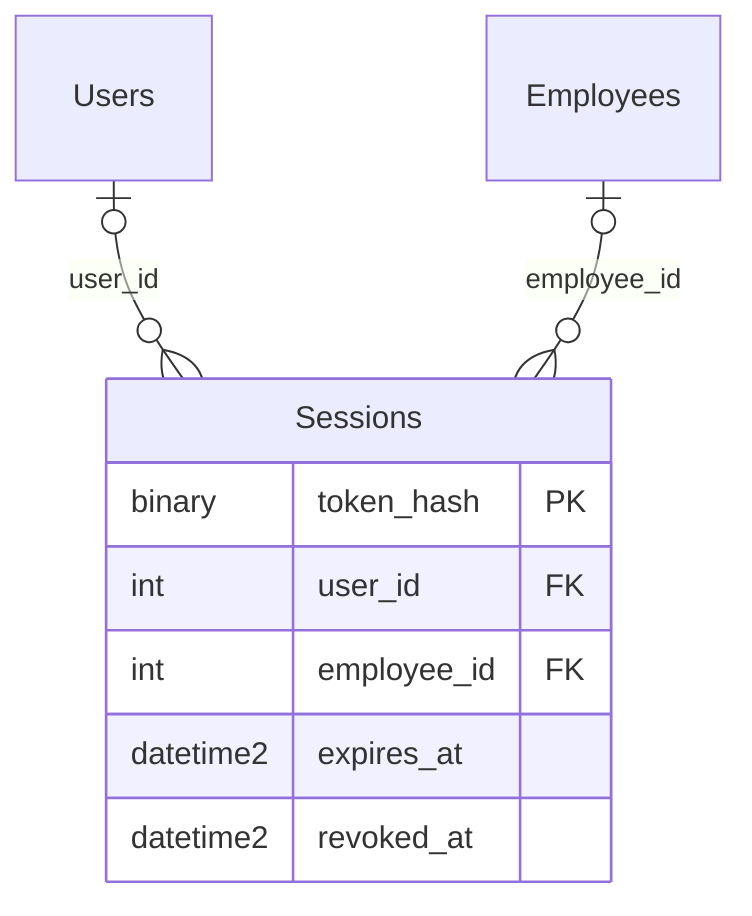

# Web应用数据字典增量

业务结构继承[v1.1数据字典](../week6/v11/data_dictionary_v11.md)：17张业务表、20条可信外键。新增app.Sessions后共18表22外键，不把兼容视图UsageSummary计作物理表。

| 字段 | SQL类型 | 键及规则 |
|---|---|---|
| token_hash | BINARY(32) | PK；随机令牌SHA256摘要，不保存原令牌 |
| user_id | INT NULL | FK→Users；顾客会话 |
| employee_id | INT NULL | FK→Employees；员工会话 |
| expires_at | DATETIME2(0) | 必填；创建后8小时 |
| revoked_at | DATETIME2(0) NULL | 注销时间；非空会话不能使用 |

CHECK限定两个身份字段恰好一个非空。身份有效性每次结合Users/Employees.status与Roles.role_name核验，角色变更或停用立即影响后续操作。

两条父联系分别可空，但同一会话恰好选择一个；顾客和员工分别可有多个会话。整体业务ER可编辑源见[原17表模型](../week6/v11/er_diagram_v11.mmd)，本增量源见[完整18表模型](../report/er_diagram_app.mmd)。

公共过程为AuthLookup、StartSession、ResolveSession、EndSession和[Execute]，仅app_runtime获得指定执行权限；查询返回白名单字段，不包含上游密钥或用户密码哈希。AuthLookup仅供后端密码验证使用，结果不返回浏览器。

应用迁移将退款外部凭证的可空UNIQUE改为非空过滤唯一索引，允许多个awaiting_transfer记录同时存在，非空凭证仍不得重复。配对库存删除仅允许owner事务中受控账号删除路径，不关闭触发器。

期初库存由 `trg_App_OpeningInventory` 在新增上游账号时登记到既有 `InventoryLog`：`change_type=purchase`、`reference_type=manual`、`reference_id=NULL`、`reason=APP_INITIAL_QUOTA_V1`，数量为创建时 `total_quota-used_quota`，时间取账号 `created_at`。唯一过滤索引 `UX_App_OpeningInventory` 限定每个账号最多一笔此标记。未新增表、列或外键，仍为18张物理表、22个外键。

`trg_W6_InventoryLogWrite` 保留流水不可修改/删除约束，仅允许owner事务通过受控账号删除入口，删除无调用、无补货、无其它流水账号的系统期初记录。业务流水仍阻止账号删除；任意调用者设置同名会话标志不获得基表权限。
