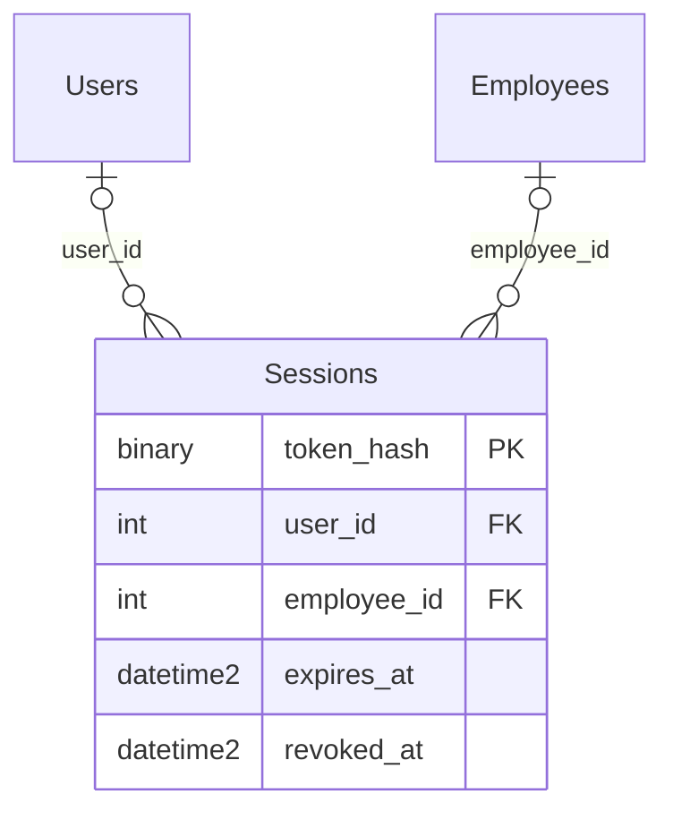

# Web应用数据字典增量

业务结构继承[v1.1数据字典](../archive/coursework/week6/v11/data_dictionary_v11.md)：17张业务表、20条可信外键。新增app.Sessions后共18表22外键，不把兼容视图UsageSummary计作物理表。

| 字段 | SQL类型 | 键及规则 |
|---|---|---|
| token_hash | BINARY(32) | PK；随机令牌SHA256摘要，不保存原令牌 |
| user_id | INT NULL | FK→Users；顾客会话 |
| employee_id | INT NULL | FK→Employees；员工会话 |
| expires_at | DATETIME2(0) | 必填；创建后8小时 |
| revoked_at | DATETIME2(0) NULL | 注销时间；非空会话不能使用 |

CHECK限定两个身份字段恰好一个非空。身份有效性每次结合Users/Employees.status与Roles.role_name核验，角色变更或停用立即影响后续操作。

两条父联系分别可空，但同一会话恰好选择一个；顾客和员工分别可有多个会话。整体业务ER可编辑源见[原17表模型](../archive/coursework/week6/v11/er_diagram_v11.mmd)，本增量源见[完整18表模型](../report/er_diagram_app.mmd)。

公共过程为AuthLookup、RegisterCustomer、StartSession、ResolveSession、EndSession和[Execute]，仅app_runtime获得指定执行权限；查询返回白名单字段，不包含上游密钥或用户密码哈希。AuthLookup仅供后端密码验证使用，结果不返回浏览器。

应用迁移将退款外部凭证的可空UNIQUE改为非空过滤唯一索引，允许多个awaiting_transfer记录同时存在，非空凭证仍不得重复。配对库存删除仅允许owner事务中受控账号删除路径，不关闭触发器。

期初库存由 `trg_App_OpeningInventory` 在新增上游账号时登记到既有 `InventoryLog`：`change_type=purchase`、`reference_type=manual`、`reference_id=NULL`、`reason=APP_INITIAL_QUOTA_V1`，数量为创建时 `total_quota-used_quota`，时间取账号 `created_at`。唯一过滤索引 `UX_App_OpeningInventory` 限定每个账号最多一笔此标记。未新增表、列或外键，仍为18张物理表、22个外键。

`trg_W6_InventoryLogWrite` 保留流水不可修改/删除约束，仅允许owner事务通过受控账号删除入口，删除无调用、无补货、无其它流水账号的系统期初记录。业务流水仍阻止账号删除；任意调用者设置同名会话标志不获得基表权限。

## 第9周 Web 扩展：受限员工管理过程

新增 app.ManageEmployees，参数为会话token哈希、明确操作名和JSON参数。过程以 app_runtime 授权执行，但内部重新确认会话属于 active 的 admin。仅支持普通 staff 的分页列表、新建、修改姓名、重置密码、状态变更，不允许修改管理员。读取字段为 employee_id、name、account、status、hire_date、role，不返回 password_hash；创建时由SQL固定查找 staff 角色，不能由用户提供 role_id。停用与重置密码会撤销 app.Sessions 中对应员工的旧会话。

复用 dbo.Employees.status 的 active/inactive，不增加实体表或外键，员工物理删除 API 不存在，维持 RestockTask/InventoryLog/ExceptionLog 和员工之间的历史引用。新脚本 sql/app/employees.sql，在 sql/app/install.sql 后执行；新建数据库由 app_prepare 自动安装。

## 第10周可选扩展

通过`--with-week10`安装后，当前应用为19张表、26条启用可信外键。第二阶段18表模型用于原交付，第10周模型见[可编辑源](../report/er_diagram_week10.mmd)与[ER图](../report/er_diagram_week10.png)。

### 定价快照

| 表与字段 | 类型 | 规则 |
|---|---|---|
| Orders.pricing_rule_version | VARCHAR(32) NOT NULL | legacy或amount-v1，空草稿也保存版本 |
| OrderDetails.original_subtotal | DECIMAL(10,2) NOT NULL | quantity乘首次unit_price |
| OrderDetails.discount_rate | DECIMAL(5,4) NOT NULL | legacy为0，新版本为0/0.05/0.10 |
| OrderDetails.discount_amount | DECIMAL(10,2) NOT NULL | 原价乘折扣率，逐行四舍五入至分 |
| OrderDetails.pricing_rule_version | VARCHAR(32) NOT NULL | 与订单重算版本一致 |
| OrderDetails.subtotal | DECIMAL(10,2) NOT NULL | 原价减优惠后的成交小计，退款基数 |

### w10.InventoryAdjustments

| 字段 | 类型 | 规则 |
|---|---|---|
| adjustment_id | BIGINT IDENTITY | 主键 |
| operation_key | UNIQUEIDENTIFIER | 唯一重放键，同键同参返回原记录 |
| product_id | INT | 非空FK到Products |
| account_id | INT | 非空FK到UpstreamAccount |
| operator_id | INT | 非空FK到Employees，过程检查有效管理员 |
| log_id | INT | 非空唯一FK到InventoryLog，每条调整恰好关联一条流水 |
| change_amount | BIGINT | 有符号非零上游Token数量 |
| reason | NVARCHAR(255) | 非空校正原因 |
| before_current_quota / after_current_quota | BIGINT | 非负，差额等于change_amount |
| before_total_quota / after_total_quota | BIGINT | 正数，差额等于change_amount |
| created_at | DATETIME2(0) | Asia/Shanghai本地时间 |

调整记录只追加。正负校正同时改变账号总额度与可用额度，已消费额度不变。manual流水reference_id保持NULL，由新表的log_id外键保存关联。数据库程序参数、异常号与SELECT示例见[第10周SQL说明](../sql/week10/README.md)。
