# 第二阶段数据库应用实验报告（第 5—9 周）

**项目名称：** TokenHub——API Token 套餐销售、库存与订单管理系统
**课程交付版本：** v1.0（规范化迁移）＋ v1.1（业务规则补充）＋ Web 应用
**验收日期：** 2026 年 11 月 4 日（第9周业务验收），2026 年 11 月 6 日（跨机器部署、显示修复及完整回归）
**验收环境：** Windows、SQL Server Express（`localhost\SQLEXPRESS`）、Python 3.12（原开发电脑）/ 3.14（肖懿电脑上的 WebXY1105F、WebXY1106S 批次）、Flask、pyodbc、Edge/Playwright
**独立验收数据库：** `TokenHubDB_v11_WebEmp26A01`（第 3—6 节截图与对账，原始来源 `TokenHubDB_v01_WebEmp26A01`）；另有 `WebXY1105F`（跨机器部署与受限账户）、`WebFinal1106A`（75 项测试）和 `WebXY1106S`（11 月 6 日重截图 14、16—21），见第 9 节

> **证据边界：** 本报告中的截图由 Microsoft Edge / Playwright 访问真实 Flask 网站自动采集（包含本机与跨机器验收批次），SQL 查询来自真实隔离数据库，不是绘制的界面样图。支付、Token 调用和结算均为模拟。**两名组员已实际参与测试：陈诗翰第一名在其环境先行测试（据阮依成确认），阮依成第二名亲自在当前网站测试登录和订单显示、发现注册缺失并推动修复。** 22张 Edge 原业务截图为自动化补充证据。**真实受限 Windows 运行账户与另一台电脑从零部署，已由肖懿于 2026 年 11 月 6 日在其电脑上完成验收（AI 辅助执行）**；截图仍由自动化采集，不冒称组员逐项手动截图。

## 1. 设计思路与数据库重构

### 1.1 应用场景与原始模型

TokenHub 提供顾客购买 OpenAI、Claude、Gemini、Other 等模型供应商 Token 套餐的演示业务。订单明细固化下单时的商品价格与 Token 份额；模拟支付后按顾客和供应商发放余额；模拟调用按 FIFO 消耗 Token 批次并减少服务器选择的上游账号库存；店员补货，管理员维护商品与账号并登记模拟退款结算。

第 5 周对原 v0.1 的 **14 张业务表、17 条外键**进行 ER 逆向，核对实体标识、候选码、联系基数、强制/可选参与及现有数据库实际约束。区分业务希望成立的规则与现有 PK、FK、UNIQUE、CHECK 真正保证的规则，避免仅凭样例数据推断强制参与。完整分析见 [第五周设计](../archive/coursework/week5/README.md)、[ER 图](../archive/coursework/week5/er_diagram.png)、[业务规则映射](../archive/coursework/week5/business_rules_mapping.md)与[独立复核](../archive/coursework/week5/independent_review.md)。

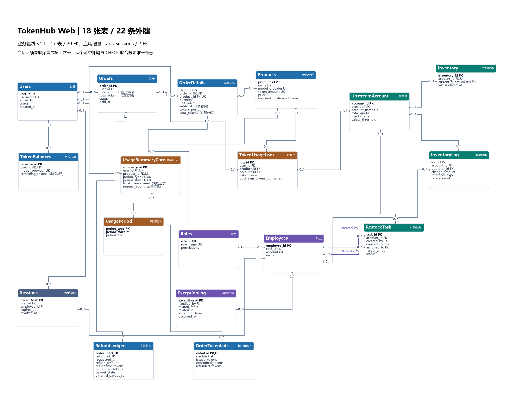

*图 1：包含业务实体、应用会话与关联的最终应用 ER；图源为 [er_diagram_app.mmd](er_diagram_app.mmd)，渲染代码保留于 [render_app_er.py](render_app_er.py)。*

### 1.2 函数依赖、范式与更新异常

第 6 周逐表分析主码与候选码决定的函数依赖，识别原 `UsageSummary` 同时保存 `period_type`、`period_start` 和可推导的 `period_end` 带来的更新异常。自然日、周一至周日及自然月的规则决定：

```text
(period_type, period_start) → period_end
```

如果同一周期有多条统计记录，改变周期结束日期必须同步更新多行；插入尚无汇总的周期和删除最后一条汇总也会影响周期元数据。采用 `UsagePeriod` 保存周期定义，`UsageSummaryCore` 保存业务统计和对周期的外键，二者通过周期主键连接，无损并保留关键函数依赖。兼容的同名 `UsageSummary` 视图仅提供旧查询入口，不接收旧 INSERT。

订单成交快照、订单汇总及 Token 余额等字段不简单当作违规冗余删除：它们分别属于交易历史事实与业务维护的数据，靠约束、受控过程和事务保持一致。原有表的保留、拆分及业务理由见[函数依赖与范式分析](../archive/coursework/week6/dependency_normalization.md)、[重构方案](../archive/coursework/week6/redesign_decisions.md)及[更新异常清单](../archive/coursework/week5/v01_issues.md)。

### 1.3 迁移、完整性与回归

迁移链为：

```text
v0.1 旧结构及固定样例
  └→ COPY_ONLY/CHECKSUM 备份、VERIFYONLY
      └→ v1.0：周期元数据无损分解 + 回归
          └→ v1.1：订单批次、库存/事务加固、受控退款
              └→ Web：app.Sessions、鉴权过程、受限顾客注册
```

核心课程脚本保留在 **[`sql/v10/migration.sql`](../sql/v10/migration.sql)** 和 **[`sql/v10/regression.sql`](../sql/v10/regression.sql)**；第六周其它业务更新在 [`sql/v11/`](../sql/v11/README.md)。迁移采用新建数据库副本，不覆盖原 v0.1；回归比较订单、金额、商品销量、库存、余额及汇总等关键查询，并检验权限和外键。完整构建可执行 `tools/app_prepare.py --suffix <新后缀>`（每次使用从未用过的后缀），逐阶段日志可在 [WebEmp26A01 构建证据](../result/webapp/WebEmp26A01/)中查看。

最终在本轮隔离库实测：**18 张表、22 条启用且可信的外键**（包含 17 张业务表及 1 张 Web 会话表；v1.1 业务层 20 条外键）。第 1—4 周的 v0.1 SQL 作为**迁移依赖**继续放在 `sql/v01/`，历史报告与证据归档在 [archive](../archive/README.md)。

## 2. Web 程序结构与业务实现

### 2.1 四层结构

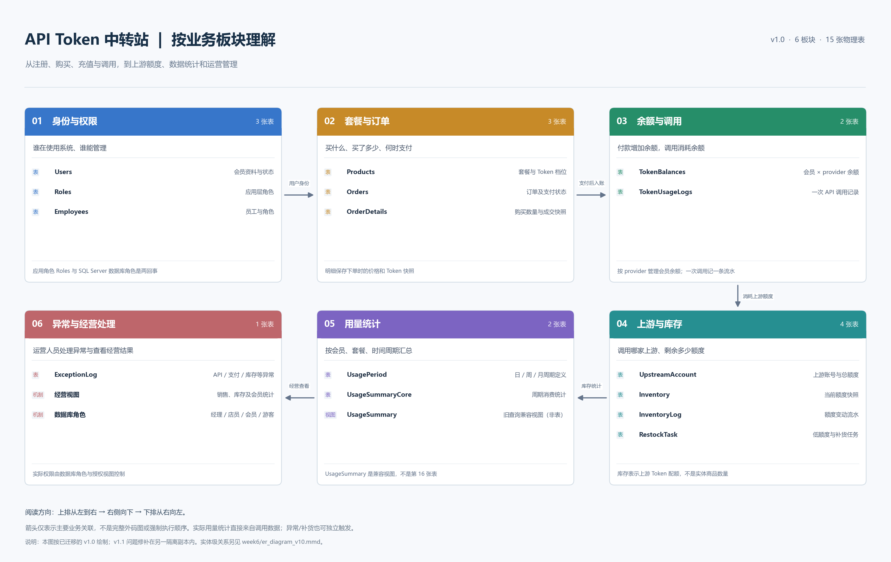

*图 2：四层分层及模块关系。可编辑原稿 [overview_modules.mmd](overview_modules.mmd)，渲染脚本 [render_overview_modules.py](render_overview_modules.py) 均保留。*

| 层次 | 核心文件 | 职责 |
|---|---|---|
| 页面层 | `webapp/templates/index.html`、`webapp/static/app.js` / CSS | 导航、表单、搜索、分页、角色界面及友好提示；调用 JSON API |
| HTTP 边界 | `webapp/__init__.py` | 路由、同源请求、CSRF、Session、统一异常响应和请求日志 |
| 业务层 | `webapp/services.py` | 输入验证、密码哈希、顾客/员工身份解析、角色和订单归属检查 |
| 数据访问层 | `webapp/dao.py` | 唯一 SQL Server 访问入口；pyodbc 参数绑定、连接管理、提交/回滚、断线归类 |
| 数据库层 | `sql/v10/`、`sql/v11/`、`sql/app/` | 关系约束、迁移、存储过程、授权与事务一致性 |

**查询示例：** 网页商品目录 → `GET /api/v1/products` → 业务层角色/参数处理 → DAO 参数化调用 `app.[Execute]` → SQL Server `Products`。
**修改示例：** 顾客创建订单 → `POST /api/v1/orders` → 校验顾客身份和明细 → DAO 工作单元 → SQL 受控订单创建过程 → 写 `Orders`、`OrderDetails` → 整笔事务提交；任一步失败回滚。

### 2.2 角色权限及注册

| 功能 | 游客 | 顾客 | 店员 | 管理员 |
|---|---|---|---|---|
| 浏览在售商品 | √ | √ | √ | √ |
| 自助注册普通顾客 | √ | — | — | — |
| 创建订单及编辑本人待支付明细、模拟支付 | — | √ | — | — |
| 查询订单 | — | 仅本人 | 全部 | 全部 |
| 取消待支付订单 | — | 本人 | √ | √ |
| 查看库存、创建/完成补货 | — | — | √ | √ |
| 商品/上游账号增改和必要删除 | — | — | — | √ |
| 提交本人未消费部分退款 | — | √ | — | — |
| 查看退款账本 | — | 本人 | 全部 | 全部 |
| 登记模拟结算、删除符合规则的空订单 | — | — | — | √ |

页面隐藏无权限按钮，后端 `services.py` 与数据库过程再次校验。顾客注册 `POST /api/v1/auth/register` 只允许创建 `Users` 普通账号：3—50 位英文/数字/下划线用户名、有效格式邮箱、12—72 字节密码与二次确认；bcrypt 哈希存储，数据库唯一约束拒绝同名和同邮箱，无法通过提交 `role` 或 `employee_id` 提权。注册成功创建会话并自动登录。登录入口明确区分顾客与员工；员工允许多个账号共用 `staff` 角色，但未提供公开自助注册。

页面“**待处理**”对应数据库 `pending`，业务上指**顾客尚未模拟支付**，并不表示等候店员/管理员审批。店员和管理员可查看、取消待支付单，但不能替顾客模拟支付。

## 3. 实际实验环境与验收方法

2026 年 11 月 4 日，以新后缀 `WebEmp26A01` 从空 v0.1 构建完整系统，启用本机 **5052** 的独立预览网站，以 Edge + Playwright 真实浏览器操作采集屏幕；原供人工测试的 **5050 / `WebManualA01`** 数据库未用于本次验收。录制结果、每一张 PNG 的 SHA-256、HTTP 请求编号和最终读库检查保存在：

- [浏览器执行清单（42 条）](../result/stage2/WebEmp26A01/browser/manifest.json)
- [截图清单与实际图像（22 张）](../result/stage2/WebEmp26A01/README.md)
- [SQL 只读对账结果](../result/stage2/WebEmp26A01/database_reconciliation.json)
- [66 项单元和集成测试日志](../result/webapp/WebSign28A/registration_unit_stderr.log)

浏览器脚本为 [`tools/stage2_browser_e2e.py`](../tools/stage2_browser_e2e.py)，只读对账脚本为 [`tools/stage2_reconcile.py`](../tools/stage2_reconcile.py)；其他测试覆盖连接失败、约束冲突、事务回滚、跨顾客访问、并发扣费/退款、CSRF 与接口参数化。

## 4. 浏览器实测——正常业务流程

### 4.1 注册与商品维护

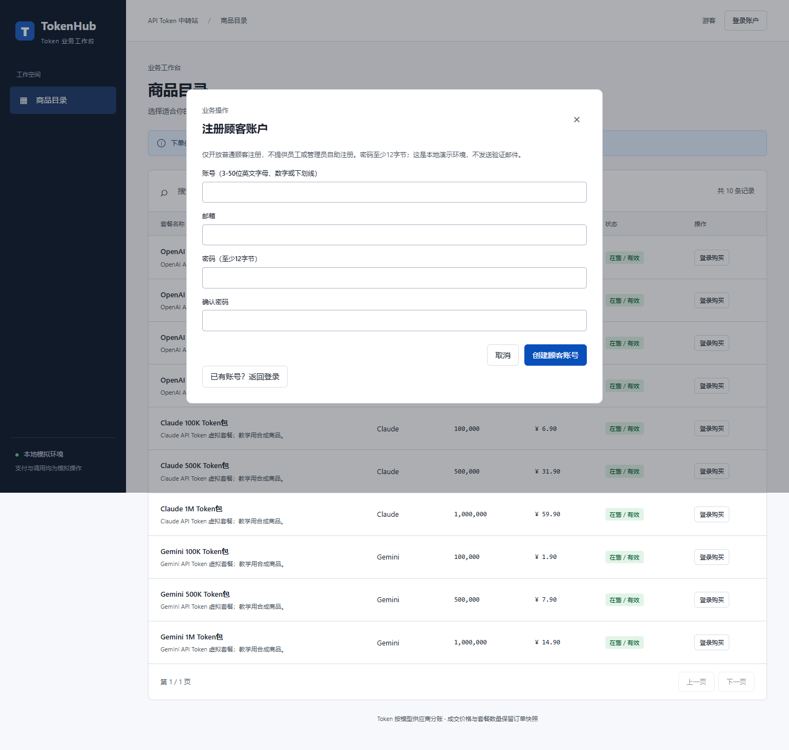

*图 3：实际 Edge 页面中的顾客注册表单（填写前）。随后以 `stage2_new_A01` 注册，成功后自动以顾客身份登录，见浏览器执行清单。*


*图 4：管理员创建 Other 供应商商品 `Stage2验收套餐P_A01`，单价 12.00 元、135,791 Token；数据库生成商品 #18。随后创建上游账号 #18，初始库存 1,000,000 Token。*

### 4.2 顾客订单与支付

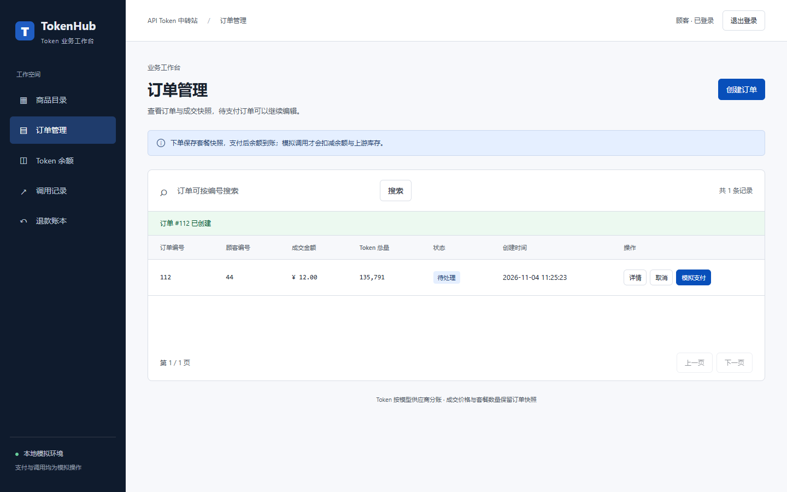

*图 5：顾客 `web_customer` 新建订单 #112，状态 pending，金额 12.00 元、135,791 Token。*

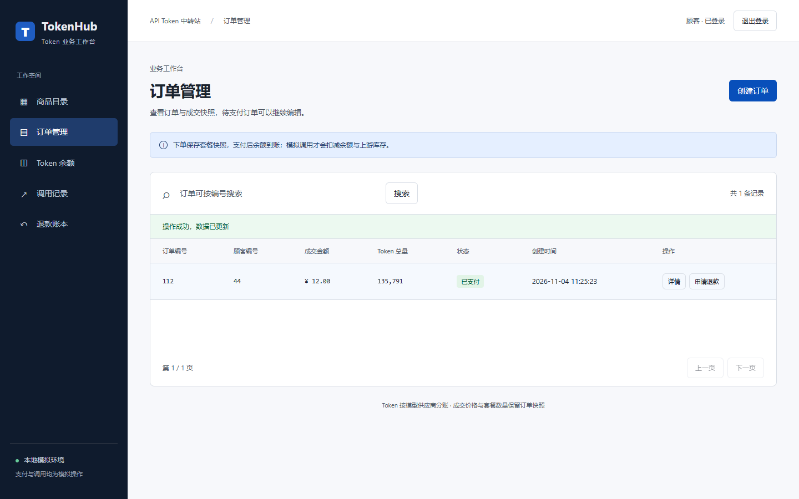

*图 6：点击模拟支付后，订单状态变为“已支付”（paid）。Token 进入顾客 Other 余额与购买批次、支付时不扣上游库存，由第 6 节 SQL 对账核实。*

### 4.3 Token 消费与退款结算

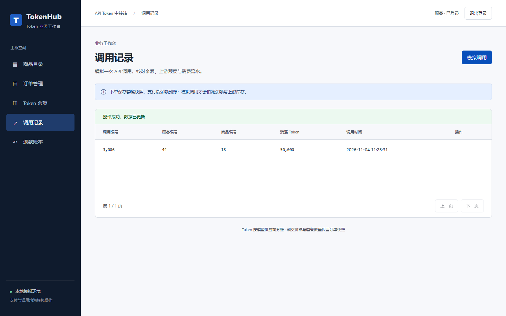

*图 7：调用记录显示本次对商品 #18 消费 50,000 Token。消费后剩余 85,791 Token，扣费的是已有的 Other 上游账号 #17（而非本轮新建的 #18），由第 6 节 SQL 对账核实。*

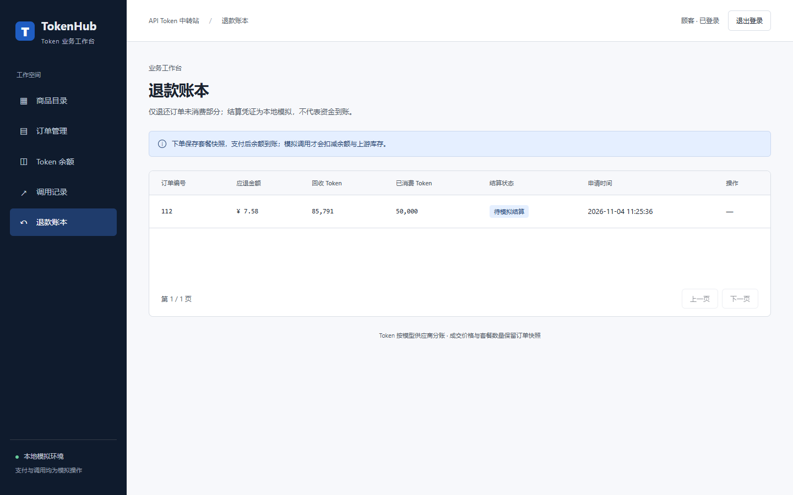

*图 8：顾客对订单 #112 申请退款，收回未消费的 85,791 Token，已消费 50,000 Token 不退款；账本给出应退 **7.58 元**，等待模拟结算。*

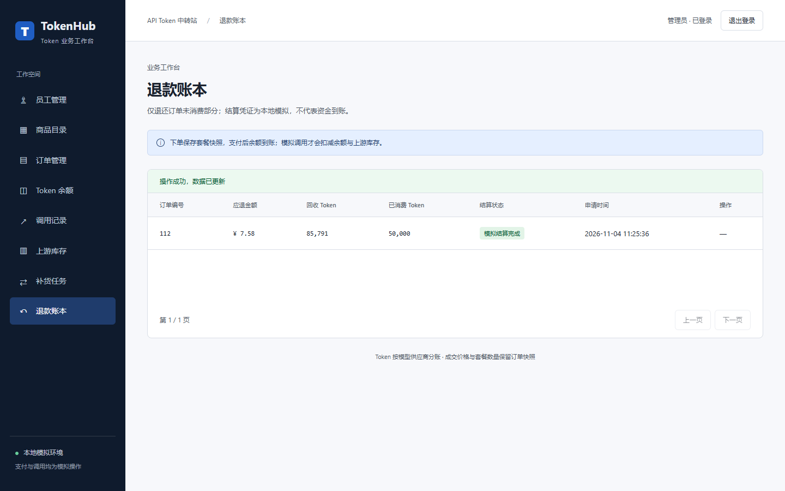

*图 9：管理员将该笔退款登记为 `settled`，生成 `SIM-` 开头的本地演示编号，**不代表实际资金已划转**。*

### 4.4 店员受控补货

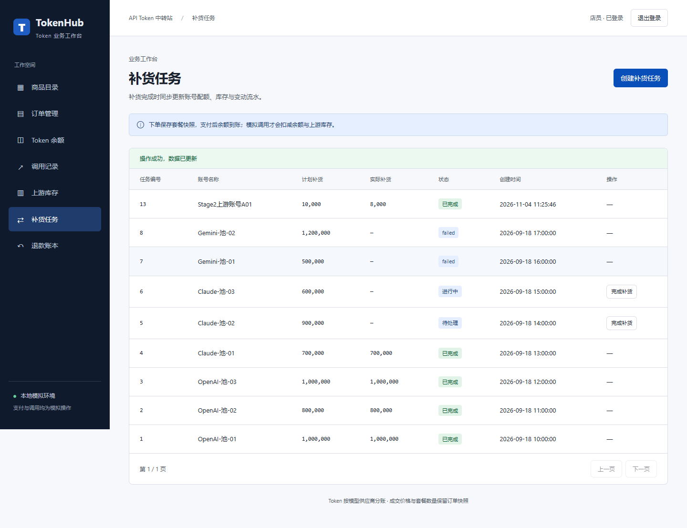

*图 10：店员完成补货任务 #13：对新建账号 `Stage2上游账号A01`（#18）计划补货 10,000 Token、实际完成 8,000 Token。该账号库存由 1,000,000 变为 1,008,000，见第 6 节 SQL 对账。*

## 5. 浏览器实测——异常、安全与统一反馈

所有请求统一返回 `code`、`message`、`data`、`request_id`，前端只显示简明提示和请求编号，不输出 SQL、服务器路径、密码或原始异常堆栈。后端记录时间、操作名、角色、错误分类和 HTTP 状态。

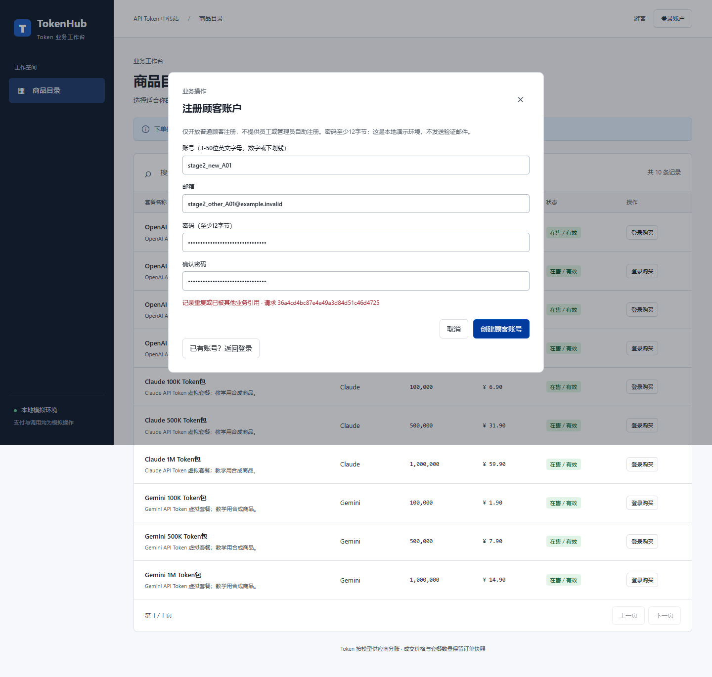

*图 11：注册使用已存在的用户名，被唯一性约束拒绝；读库确认注册用户仅 1 行，失败注册没有产生第二条账号。*


*图 12：错误密码返回统一的登录失败提示，不暴露密码哈希。*

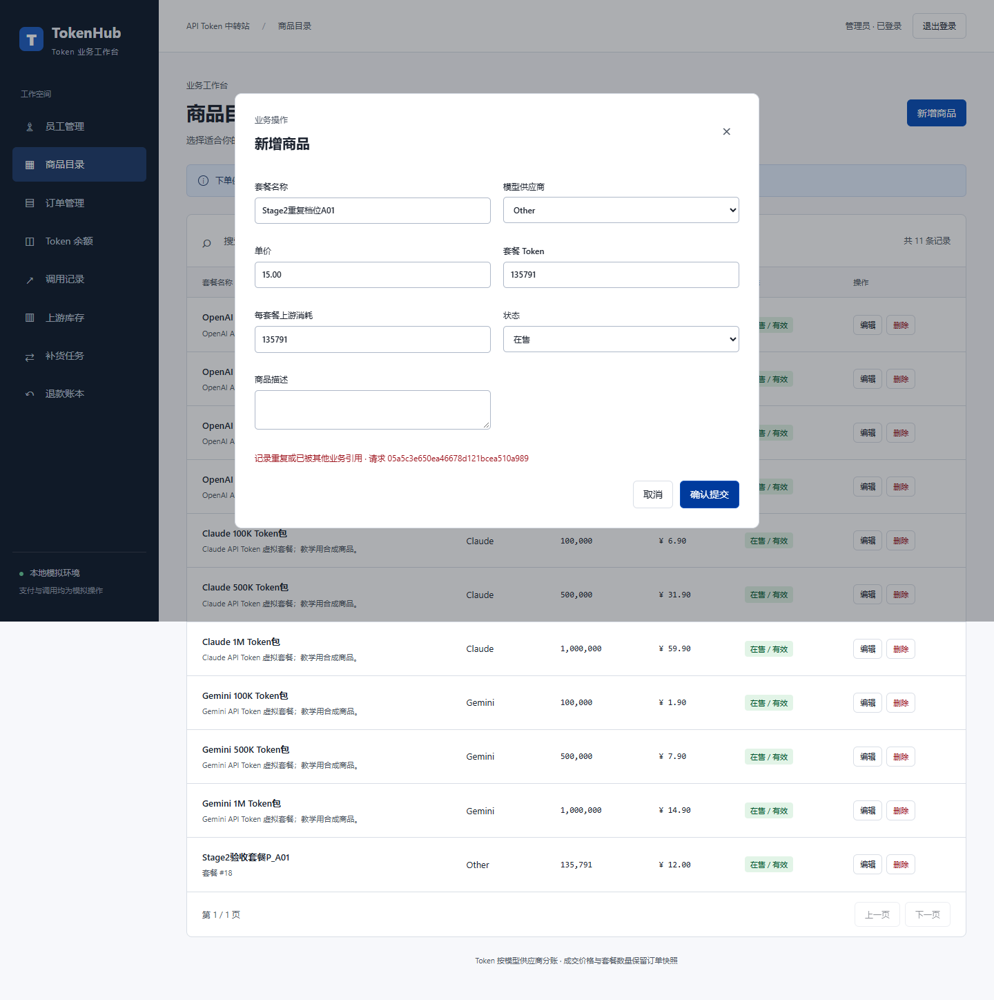

*图 13：管理员尝试创建相同供应商与 Token 档位商品，触发数据库 UNIQUE 约束，由 HTTP 错误边界转换为友好提示。*

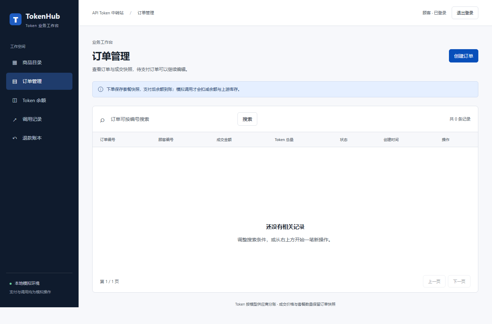

*图 14：第二位顾客 `web_other` 登录后的订单管理页，列表为空，看不到第一位顾客的订单 #112；同一会话直接请求 `GET /api/v1/orders/112` 返回 403 `FORBIDDEN`。WebEmp26A01 批次的原截图停在登录后的商品目录页，没有进入订单列表，因此 11 月 6 日修正截图脚本后在新批次 WebXY1106S 重截；该批次流程相同，订单同为 #112，请求编号 `678fa865a5d444818b004504d077f503` 见[该批次执行清单](../result/stage2/WebXY1106S/browser/manifest.json)。下表请求编号仍来自 WebEmp26A01。*

| 异常或反例 | 实际响应 | 证据 |
|---|---|---|
| 新顾客重复用户名 | HTTP 409，约束冲突 | 图 11；只读计数 = 1 |
| 错误顾客密码 | HTTP 401，`LOGIN_FAILED` | 图 12 |
| 重复商品供应商/Token 档位 | HTTP 409，`CONSTRAINT_CONFLICT` | 图 13 |
| 非法负数消费 `tokens_used=-1` | HTTP 400，`INVALID_INPUT` | 请求 `46a2c3b8ef12438aaefd0215f34c6ce1` |
| 第二位顾客获取订单 #112 | HTTP 403，`FORBIDDEN` | 请求 `0b8a48de0b184266942755ec4ea51c17` |
| 店员尝试新建商品 | HTTP 403，`FORBIDDEN` | 请求 `502cee9f963a4d8cbe14043ba0958c57` |
| 退款后继续消费已回收余额 | HTTP 409，`BUSINESS_RULE` | 请求 `70bfe773251e4a5285eac632c079aab2` |
| 重复两次申请同笔退款 | 两次 HTTP 200，返回原退款数据 | 请求编号在 [执行清单](../result/stage2/WebEmp26A01/browser/manifest.json) |
| 管理员删除已支付/已退款订单 | HTTP 409，`BUSINESS_RULE` | 请求 `82d201cc42994771ad60e1cd0e20f218` |
| 游客直接访问订单接口 | HTTP 401，未登录 | [真实接口页面截图](../result/stage2/WebEmp26A01/browser/screenshots/21_游客访问订单401.png) |
| SQL 注入样式字符串作为商品搜索词 | HTTP 200，按普通文本处理，未执行 DDL | 执行清单及 18 表结构仍存在 |

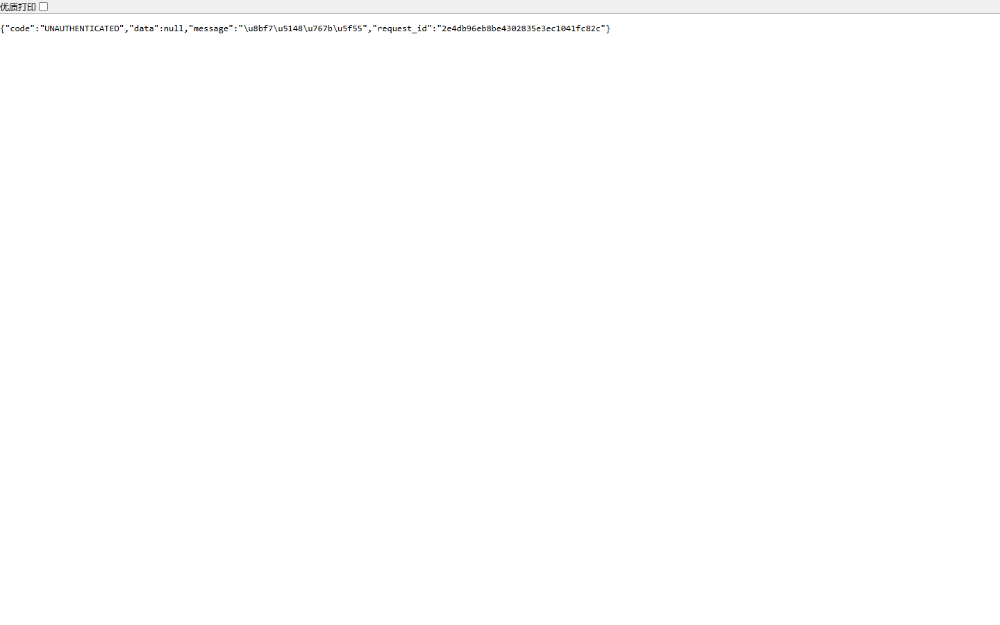

*图 15：游客用 Edge 直接打开受限的订单 API 地址，网站实际返回 401 JSON 错误（`UNAUTHENTICATED`），而非由测试脚本伪造的错误图。*

此外，完整自动化测试覆盖 CSRF 缺失、数据库连接失败脱敏、支付/补货/退款中途故障回滚，以及模拟并发冲突。此类故障注入主要由独立测试代码触发，**未将其伪装为浏览器截图中的故障现场**。

## 6. 只读 SQL 对账及自动化测试结果

对浏览器流程结束后的 `WebEmp26A01` 数据库进行真实 SQL 查询，独立脚本执行 **25 项关键数据核验**；同时检查 22 张 PNG 的签名、尺寸和 SHA-256。结果均通过。

| 核对项目 | 浏览器前后业务事实及 SQL 查询结果 |
|---|---|
| 新顾客注册 | `stage2_new_A01` 仅 1 行，重复注册没有新增账户 |
| 订单和明细 | #112 仅 1 项明细，订单 12.00 元、135,791 Token；明细汇总与订单头一致 |
| 余额发放与消费 | 模拟支付获得 135,791 Token；成功调用消耗 50,000 Token |
| 退款 | 85,791 Token 回收，50,000 Token 已消费，退款 7.58 元，状态 `partially_refunded`、账本 `settled` |
| 退款后余额 | 顾客 Other 的现存余额 = 0 |
| 实际调用上游账号 | #17 `Web Other`，库存从 100,000,000 → **99,950,000**，该账号库存与流水求和相等 |
| 新增及补货账号 | #18 `Stage2上游账号A01`，1,000,000 + 8,000 → **1,008,000**，流水合计也为 1,008,000 |
| 当前数据库结构 | 18 张表、22 条启用可信外键 |
| 截图真实性 | 22 张由 Edge 生成的 PNG 均存在、尺寸有效、SHA-256 与执行清单一致 |

完整 JSON：[`database_reconciliation.json`](../result/stage2/WebEmp26A01/database_reconciliation.json)。

另一套独立环境 `TokenHubDB_v11_WebSign28A` 的 **66 项 Python 测试全部通过（0 失败、0 跳过）**，包含旧数据库基础回归、Web SQL、HTTP 业务、登录与注册、安全边界、锁竞争和异常回滚。浏览器与数据库核对的证据是本轮新建的 `WebEmp26A01`，不将不同数据库的结果混在同一“执行场次”中。此前第8周另执行过 [10 项最终 QA](../result/stage2/WebStage2A02/final_qa_manifest.json)，包括第5/6周图与链接、迁移回放、Ruff、网站登录和截图哈希检查。第9周另在 WebEmp26A01 运行新增员工管理后的 **72 项完整 unittest，全部通过**，其[原始日志](../result/stage2/WebEmp26A01/unittest_rerun_stderr.log)单独保存；截图结束时的25项数据库核对保存在[独立 JSON](../result/stage2/WebEmp26A01/database_reconciliation.json)，之后完整测试会继续写入独立库，因此不将最终库的动态业务值与截图时间点混为同一快照。

## 7. 实验总结与交付边界

本阶段完成了从 v0.1 ER 建模、函数依赖和范式检查，到 v1.0 规范化迁移、v1.1 业务加固及 Web 四层应用的完整实现链。主要成果是：保留历史快照与有依据的受控冗余；将订单与 Token 更新纳入同一事务；通过双层角色检查及受限 SQL 过程保证店员、顾客、管理员权限；使用参数化调用、CSRF 与统一异常边界减少注入和内部信息泄露。浏览器及 SQL 联合验证可及时发现“上游账号自动选择”与“页面显示”等单层测试无法充分说明的问题。

**成员网站验收已完成：** 第一名测试组员陈诗翰在其环境先行测试（据阮依成确认）；第二名阮依成亲自在网站检查登录和订单显示，发现并要求修复缺失的注册功能。自动化22张浏览器截图与25项SQL对账另行记录，不冒充组员逐项手动截图。此后肖懿于 **2026 年 11 月 6 日**在另一台全新 Windows 电脑（其本人电脑，AI 辅助执行）完成从空库部署、真实受限账户启动、SQL 最小权限核验，以及该账户运行网站的业务与员工管理浏览器复测；详细证据另列于第9节。

本报告不声称验证了真实支付网关、真实上游模型 API 或真实退款到账。具体软件版本、操作手册、错误码与日志位置见[根 README](../README.md)、[Web 手册](../docs/webapp.md)、[第二阶段证据总览](../result/stage2/WebEmp26A01/README.md)，任务归属见[小组分工](../docs/team_division.md)，AI 辅助过程见[AI 使用文档](../docs/ai使用文档.md)和[详细日志](../docs/ai_usage_log.md)。

## 8. 第9周：员工管理补充与新一轮实际截图

第9周分工：陈诗翰继续完成其负责版本的测试与更新（据阮依成提供的分工说明登记）；阮依成作为第二名测试组员，在实际操作时发现管理员缺少管理店员的页面和操作按钮，提出新增员工管理功能，并组织测试、截图与交付更新。

### 8.1 设计与实现

数据库 Employees 已具备 staff/admin 角色、用户名唯一约束及 active/inactive 状态。InventoryLog、RestockTask 和 Sessions 会引用员工，因此不采用直接物理删除；新增管理界面采用停用和重新启用，保留历史操作的可追溯性。

管理员可查看普通店员列表、新增店员、修改姓名、重置密码、停用与重新启用。创建员工时后端只分配 staff 角色，不能通过用户提交 role 来提升权限；管理员账号不能通过普通店员管理接口修改或停用。重置密码和停用时，员工的旧会话会立即撤销。员工列表不返回密码或密码哈希。前端按角色隐藏入口，后端业务权限表与 SQL 过程又分别验证当前管理员身份。没有员工 DELETE 路由，避免破坏业务引用。

实现位置：[SQL 存储过程](../sql/app/employees.sql)、[Web 页面](../webapp/static/app.js)、[路由](../webapp/__init__.py)、[服务层](../webapp/services.py)、[参数化 DAO](../webapp/dao.py)、[测试](../tests/test_employee_management.py)。新库经 SQL 安装脚本自动包含此扩展，旧数据库无需重建即可单独安装新增存储过程。

### 8.2 实际 Edge 正常与异常截图

本轮在全新隔离库 TokenHubDB_v11_WebEmp26A01 重新执行并截图前面22个顾客/管理员/店员业务场景，此外截图员工管理的11个场景。11 月 4 日的员工管理截图摄于员工姓名列修复之前（表头误为“套餐名称”、行内有“套餐 #undefined”，见 9.2 节），保留在[原验收清单](../result/stage2/WebEmp26A01/README.md)；以下图 16—21 为 11 月 6 日修复后，在新批次 WebXY1106S 上用同一脚本重新截取（[员工执行清单](../result/stage2/WebXY1106S/employees/manifest.json)）。以下图像均为真实浏览器操作生成的 PNG，而非绘制的示意界面。


*图 16：新增普通店员“员工管理验收甲”（`employeeA01`）成功，列表出现该账号，角色为店员；表头为“员工姓名”，各行只显示员工姓名，即姓名列修复后的界面。新增表单只有姓名、账号和密码，没有角色选项（见图 17）。*

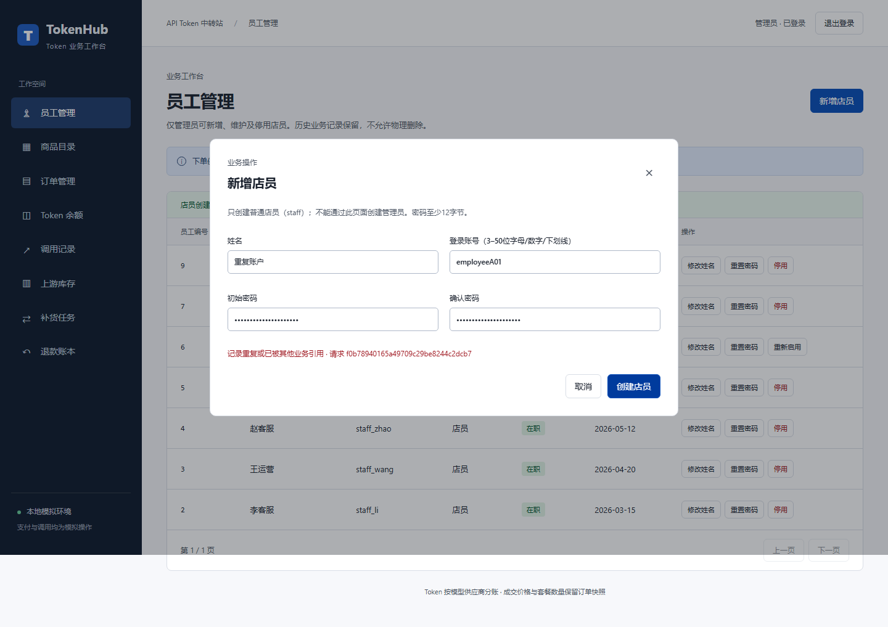

*图 17：用已存在的账号再次新增店员，被数据库唯一约束拒绝，统一异常处理返回 409 并给出友好提示。*


*图 18：员工姓名修改成功，员工编号不变，已有业务引用保留。*


*图 19：停用后该员工状态变为“已停用”，记录仍然保留。停用后不能登录、旧会话被撤销，由[员工管理测试](../tests/test_employee_management.py)验证。*

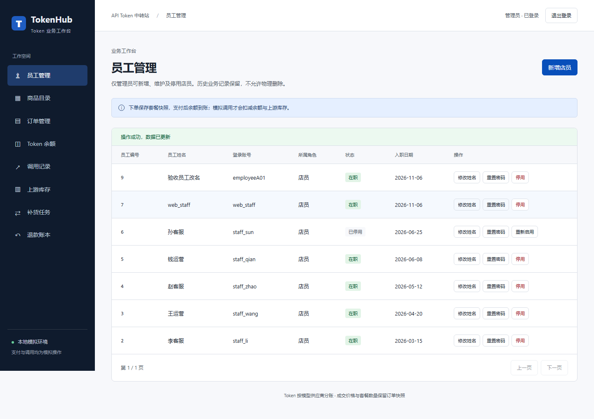

*图 20：重新启用后状态恢复为“在职”；用重置后的新密码登录见图 21 的说明。*

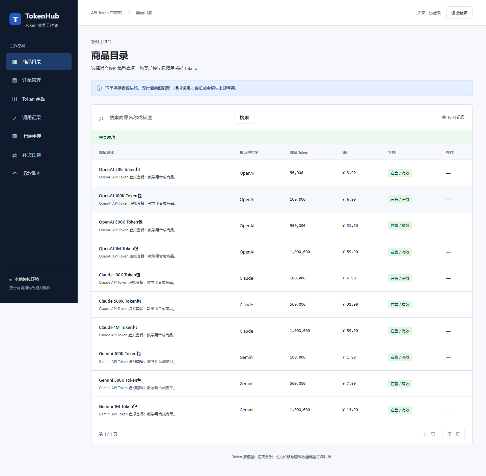

*图 21：普通店员 `web_staff` 登录后，导航中没有员工管理入口；同一会话直接请求员工 API 返回 403 `FORBIDDEN`（请求 `320fcac18606405b8276312501a5daa3`）。新建店员 `employeeA01` 用重置后的密码登录后，看到的界面与此完全相同（两张截图逐字节一致，未重复放入报告），说明新店员只获得普通店员权限。*

异常还包括：游客查询员工信息返回401、恶意提交 role=admin 被400拒绝、重复员工账号409、没有员工 DELETE 路由（请求返回405）。上述真实 HTTP 代码、request_id、截图哈希见[第9周员工管理截图与事件记录](../result/stage2/WebEmp26A01/README.md)及 [11 月 6 日重截记录](../result/stage2/WebXY1106S/README.md)。

首次员工管理自动化脚本在“新密码”与“确认新密码”定位重叠处报错。保留原失败记录、修正 Playwright 标签定位后使用新测试账号完成11张截图；该错误属于测试脚本定位问题，不是后端员工业务错误。

### 8.3 回归验证与人员分工

新库上重新执行原始完整业务流程的22张截图和42条请求，25项订单金额、库存及退款 SQL 数据核对全部通过；独立员工管理的11张新图亦通过。自动化截图由AI辅助执行，不能说成组员逐张手动操作。陈诗翰负责第9周后续测试及更新，阮依成负责第9周员工管理增补、测试组织、截图和第二阶段文档更新。


## 9. 2026 年 11 月 6 日：跨机器部署、显示修复及完整回归

### 9.1 肖懿的新环境部署与真实受限账户验收

此前的 SQL 模拟身份和开发预览不能证明普通 Windows 账户可以正常运行网站。11 月 6 日，**肖懿**在一台此前没有部署过本项目的 Windows 电脑上，以新后缀 WebXY1105F 从 v0.1 空库完成 v1.0 规范化迁移、v1.1 加固、Web 安装和受限账户实际运行，具体操作由 AI 辅助在其电脑上执行，过程与肖懿的各项决定见 [AI 使用文档](../docs/ai使用文档.md)；具体环境与失败修复经过见[新环境验收报告](../result/stage2/WebXY1105F/README.md)。这一项此前缺少独立实测记录，现已取得新电脑上的成功验收证据。

| 验证项目 | 实测结果与原始证据 |
|---|---|
| 独立从空库构建 | WebXY1105F 完整建库成功，v1.1 的 VFY01—VFY14 均 PASS（[数据库验证日志](../result/week6/v11/WebXY1105F/validation_verify_v11_full.sql.log)） |
| 普通 Windows 服务账户 | TokenHubWebF 启动网站，计划任务以 Limited 级别运行，5050 监听进程属于该账户（[Windows 运行记录](../result/stage2/WebXY1105F/runtime/windows_runtime.json)） |
| SQL Server 最小权限 | 该账户 sysadmin=0、db_owner=0；直接读业务基表、改商品、执行 DDL 均被拒绝，授权的商品目录查询成功（[身份检查](../result/stage2/WebXY1105F/runtime/runtime_identity.log)、[SQL 权限检查](../result/stage2/WebXY1105F/runtime/sql_principal_check.log)） |
| HTTP 验证 | 首页状态 200、商品 API 返回 OK 和 10 项商品（[冒烟测试](../result/stage2/WebXY1105F/runtime/http_smoke.json)） |
| 原业务浏览器 E2E | Edge 自动运行 22 张截图、42 条操作事件，图片 SHA-256 全部匹配（[浏览器清单](../result/stage2/WebXY1105F/browser/manifest.json)） |
| 员工管理浏览器 E2E | Edge 自动运行 11 张截图、10 条事件，图片 SHA-256 全部匹配（[员工清单](../result/stage2/WebXY1105F/employees/manifest.json)） |

独立部署还暴露并修复了五项仅在新电脑上发现的问题：回归 R12 仍引用旧机器的默认数据库名、批处理登录权限缺失、instance 目录 ACL 误操作、仓库位于其他用户目录导致运行账户无法进入，以及 Windows PowerShell 5.1 对 Flask 标准错误输出的处理导致进程提前退出。失败批次与修复经过均有记录；本报告不将这些失败批次算作通过。普通 Windows 账户的核验依据实际连接与运行进程，而不是模拟执行身份。

### 9.2 员工姓名列显示问题及真实 Edge 复核

上述新机截图审阅发现：员工管理页面的姓名列错误显示“套餐名称”，行内还出现“套餐 #undefined”。检查代码可知，webapp/static/app.js 的 renderTable() 对所有 name 字段使用了商品页面的通用渲染逻辑。11 月 6 日按页面类型修复：员工管理表头单独显示“员工姓名”，姓名行只显示实际员工姓名；商品页面仍显示“套餐名称”及其原有商品信息。修改不触及 SQL 表、员工账号或业务历史。

修复后使用实际 Microsoft Edge 访问独立库 WebEmp26A01 的临时 Flask 预览，仅登录管理员并读取员工列表和商品目录，两个页面均通过断言，截图和 SHA-256 保存于[本轮界面验收清单](../result/stage2/WebEmp26A01/ui_fix_20261106/manifest.json)。第 8.2 节的员工管理图 16—21 已换成修复后在 WebXY1106S 上重截的版本；11 月 4 日的原截图仍保留在原验收清单以便追溯。

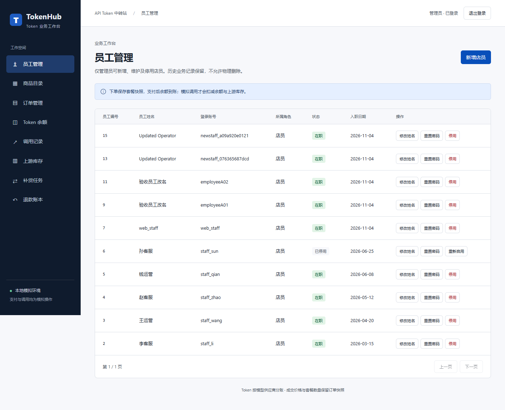

*图 22：员工管理的姓名列显示“员工姓名”，不再出现误用商品字段造成的“套餐 #undefined”。*

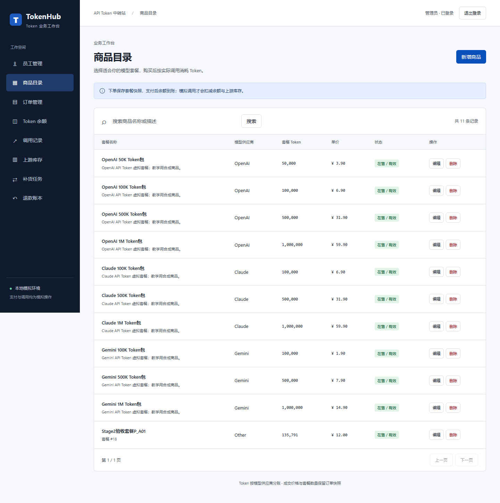

*图 23：商品目录依旧使用“套餐名称”，说明本次修复没有改变原商品页面的显示规则。*

### 9.3 新隔离库全量 75 项 Python 测试

为避免在人工演示库或原浏览器验收库中重复写入订单与员工数据，本次使用从未使用过的后缀 **WebFinal1106A**，由 app_prepare.py 独立建立 v0.1、v1.0、v1.1 及 Web 数据库，然后执行完整的 Python unittest discover -s tests -v。新增的备份目录权限3项测试也包含在此次全量套件中。

| 检查项目 | 2026 年 11 月 6 日结果 |
|---|---|
| 从空 v0.1 建库至 v1.1 Web | **PASS**（[完整准备日志](../result/stage2/WebFinal1106A/database_setup.log)） |
| 实际运行的测试数量 | **75 项** |
| 失败与错误 | **0** |
| 跳过 | **0** |
| 完整测试结论 | **OK**（[75 项 unittest 原始日志](../result/stage2/WebFinal1106A/unittest75_stderr.log)） |

此套件涵盖数据库和授权、约束及回滚、HTTP/CSRF、角色隔离、顾客注册、员工新增与会话撤销、库存补货及订单退款等。测试会写入专门的独立库，不将其最终库存值与此前浏览器截图完成时的快照混为一谈。证据总览见[本轮完整测试结果](../result/stage2/WebFinal1106A/README.md)。

### 9.4 报告截图复核与重截

肖懿要求复核本报告的截图与图注。AI 逐张比对后列出问题，肖懿确认图 14 有误，决定全部修复并重新截图。发现的问题是：原图 14 停在商品目录页而非订单列表；原图 22、23 截于数据加载完成之前（表格显示“正在读取数据…”）；原图 16 与原图 24 是同一张图；员工管理截图仍是姓名列修复前的界面；另有几处图注写了图上看不到的内容。

修正只涉及截图脚本，网站代码与 SQL 未改：`tools/stage2_browser_e2e.py` 在第二位顾客登录后进入订单管理、断言列表中没有订单 #112 再截图（5 行）；`tools/stage2_employee_browser.py` 在两张店员截图前等待数据加载完成（2 行）。随后以新后缀 **WebXY1106S** 从空 v0.1 建库至 Web（PASS），以本人身份启动预览网站（`DB_LAB_PREVIEW=1`，非受限账户核验），运行两个脚本：原业务 22 张截图、42 条事件 PASS，员工管理 11 张截图、10 条事件 PASS。业务脚本第一次运行在截第一张图时 Edge 报 `Unable to capture screenshot`，未产生任何业务事件，失败现场保留在 `browser_attempt1_failed/`，同一批次重跑通过。证据与清理记录见 [WebXY1106S 重截记录](../result/stage2/WebXY1106S/README.md)。图 14 与员工管理截图（现图 16—21）已换成该批次截图，其余截图仍来自 WebEmp26A01，图注只描述图上可见的内容，其他事实注明由执行清单、SQL 对账或自动化测试核实。

肖懿随后要求再次复查全文。复查发现，WebXY1106S 的员工列表截图 `01_管理员员工列表.png`（重截后曾作为图 16）同样截于数据加载完成之前：表格为空，显示“正在读取数据…”，表头仍是切换前商品页的“套餐名称 / 模型供应商 / 套餐 Token / 单价”，与其图注“表头为‘员工姓名’”不符。肖懿决定直接删去这张图，不再重截，并要求全文前后连贯：修复后的员工列表在图 16（新增店员后的列表）和图 22（9.2 节修复复核）中都能看到。删除后原图 17—24 依次改为图 16—23，正文中的图号引用相应修改。该截图文件仍保留在 WebXY1106S 证据目录，不计入报告。

### 9.5 最终结论与边界

截至本次补充，课程要求的第5—9周 ER 设计、函数依赖与范式分析、更新异常及分解理由、迁移与回归、Web 分层应用、全部角色正常及异常流程、参数化数据库访问、统一错误处理、AI 使用记录和小组分工均有明确交付材料。真实受限 Windows 账户运行已获肖懿跨机器实测证据，员工姓名列显示缺陷已修复，并经真实 Edge 页面复核；最新全量 75 项 Python 测试全部通过。系统仍仅模拟支付、上游 Token 消费和退款结算，并未接入真实支付网关或外部模型服务。
