# 第二阶段数据库应用实验报告（第 5—9 周）

**项目名称：** TokenHub——API Token 套餐销售、库存与订单管理系统
**课程交付版本：** v1.0（规范化迁移）＋ v1.1（业务规则补充）＋ Web 应用
**验收日期：** 2026 年 10 月 28 日
**验收环境：** Windows、SQL Server Express（`localhost\SQLEXPRESS`）、Python 3.12、Flask、pyodbc、Edge/Playwright
**独立验收数据库：** `TokenHubDB_v11_WebStage2A02`，原始来源 `TokenHubDB_v01_WebStage2A02`

> **证据边界：** 本报告中的截图由本机 Microsoft Edge 通过 Playwright 访问真实 Flask 网站自动采集，SQL 查询来自真实隔离数据库，不是绘制的界面样图。支付、Token 调用和结算均为模拟。**两名组员已实际参与测试：陈诗翰第一名在其环境先行测试（据阮依成确认），阮依成第二名亲自在当前网站测试登录和订单显示、发现注册缺失并推动修复。** 22张Edge全流程截图为自动化补充证据；真实受限Windows服务身份和新电脑从零部署仍待额外核验。

## 1. 设计思路与数据库重构

### 1.1 应用场景与原始模型

TokenHub 提供顾客购买 OpenAI、Claude、Gemini、Other 等模型供应商 Token 套餐的演示业务。订单明细固化下单时的商品价格与 Token 份额；模拟支付后按顾客和供应商发放余额；模拟调用按 FIFO 消耗 Token 批次并减少服务器选择的上游账号库存；店员补货，管理员维护商品与账号并登记模拟退款结算。

第 5 周对原 v0.1 的 **14 张业务表、17 条外键**进行 ER 逆向，核对实体标识、候选码、联系基数、强制/可选参与及现有数据库实际约束。区分业务希望成立的规则与现有 PK、FK、UNIQUE、CHECK 真正保证的规则，避免仅凭样例数据推断强制参与。完整分析见 [第五周设计](../week5/README.md)、[ER 图](../week5/er_diagram.png)、[业务规则映射](../week5/business_rules_mapping.md)与[独立复核](../week5/independent_review.md)。

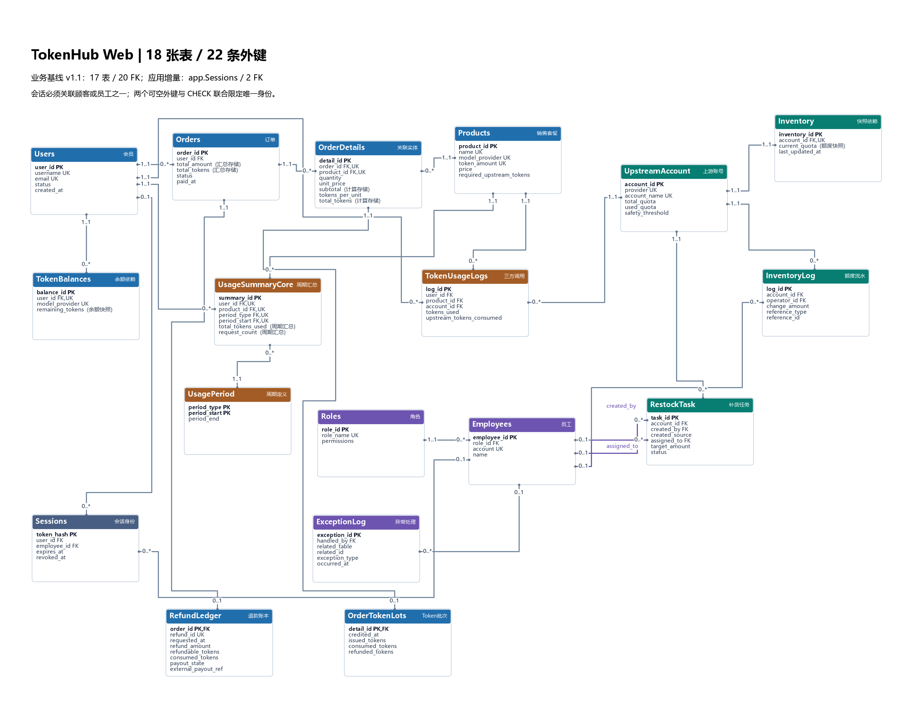

*图 1：包含业务实体、应用会话与关联的最终应用 ER；图源为 [er_diagram_app.mmd](er_diagram_app.mmd)，渲染代码保留于 [render_app_er.py](render_app_er.py)。*

### 1.2 函数依赖、范式与更新异常

第 6 周逐表分析主码与候选码决定的函数依赖，识别原 `UsageSummary` 同时保存 `period_type`、`period_start` 和可推导的 `period_end` 带来的更新异常。自然日、周一至周日及自然月的规则决定：

```text
(period_type, period_start) → period_end
```

如果同一周期有多条统计记录，改变周期结束日期必须同步更新多行；插入尚无汇总的周期和删除最后一条汇总也会影响周期元数据。采用 `UsagePeriod` 保存周期定义，`UsageSummaryCore` 保存业务统计和对周期的外键，二者通过周期主键连接，无损并保留关键函数依赖。兼容的同名 `UsageSummary` 视图仅提供旧查询入口，不接收旧 INSERT。

订单成交快照、订单汇总及 Token 余额等字段不简单当作违规冗余删除：它们分别属于交易历史事实与业务维护的数据，靠约束、受控过程和事务保持一致。原有表的保留、拆分及业务理由见[函数依赖与范式分析](../week6/dependency_normalization.md)、[重构方案](../week6/redesign_decisions.md)及[更新异常清单](../week5/v01_issues.md)。

### 1.3 迁移、完整性与回归

迁移链为：

```text
v0.1 旧结构及固定样例
  └→ COPY_ONLY/CHECKSUM 备份、VERIFYONLY
      └→ v1.0：周期元数据无损分解 + 回归
          └→ v1.1：订单批次、库存/事务加固、受控退款
              └→ Web：app.Sessions、鉴权过程、受限顾客注册
```

核心课程脚本保留在 **[`sql/v10/migration.sql`](../sql/v10/migration.sql)** 和 **[`sql/v10/regression.sql`](../sql/v10/regression.sql)**；第六周其它业务更新在 [`sql/v11/`](../sql/v11/README.md)。迁移采用新建数据库副本，不覆盖原 v0.1；回归比较订单、金额、商品销量、库存、余额及汇总等关键查询，并检验权限和外键。完整构建可执行 `tools/app_prepare.py --suffix WebNewRun01`，逐阶段日志可在 [WebStage2A02 构建证据](../result/webapp/WebStage2A02/)中查看。

最终在本轮隔离库实测：**18 张表、22 条启用且可信的外键**（包含 17 张业务表及 1 张 Web 会话表；v1.1 业务层 20 条外键）。第 1—4 周的 v0.1 SQL 作为**迁移依赖**继续放在 `sql/v01/`，历史报告与证据归档在 [archive](../archive/README.md)。

## 2. Web 程序结构与业务实现

### 2.1 四层结构

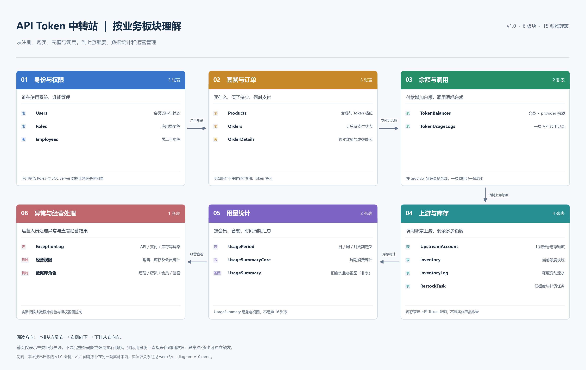

*图 2：四层分层及模块关系。可编辑原稿 [overview_modules.mmd](overview_modules.mmd)，渲染脚本 [render_overview_modules.py](render_overview_modules.py) 均保留。*

| 层次 | 核心文件 | 职责 |
|---|---|---|
| 页面层 | `webapp/templates/index.html`、`webapp/static/app.js` / CSS | 导航、表单、搜索、分页、角色界面及友好提示；调用 JSON API |
| HTTP 边界 | `webapp/__init__.py` | 路由、同源请求、CSRF、Session、统一异常响应和请求日志 |
| 业务层 | `webapp/services.py` | 输入验证、密码哈希、顾客/员工身份解析、角色和订单归属检查 |
| 数据访问层 | `webapp/dao.py` | 唯一 SQL Server 访问入口；pyodbc 参数绑定、连接管理、提交/回滚、断线归类 |
| 数据库层 | `sql/v10/`、`sql/v11/`、`sql/app/` | 关系约束、迁移、存储过程、授权与事务一致性 |

**查询示例：** 网页商品目录 → `GET /api/v1/products` → 业务层角色/参数处理 → DAO 参数化调用 `app.[Execute]` → SQL Server `Products`。
**修改示例：** 顾客创建订单 → `POST /api/v1/orders` → 校验顾客身份和明细 → DAO 工作单元 → SQL 受控订单创建过程 → 写 `Orders`、`OrderDetails` → 整笔事务提交；任一步失败回滚。

### 2.2 角色权限及注册

| 功能 | 游客 | 顾客 | 店员 | 管理员 |
|---|---|---|---|---|
| 浏览在售商品 | √ | √ | √ | √ |
| 自助注册普通顾客 | √ | — | — | — |
| 创建订单及编辑本人待支付明细、模拟支付 | — | √ | — | — |
| 查询订单 | — | 仅本人 | 全部 | 全部 |
| 取消待支付订单 | — | 本人 | √ | √ |
| 查看库存、创建/完成补货 | — | — | √ | √ |
| 商品/上游账号增改和必要删除 | — | — | — | √ |
| 提交本人未消费部分退款 | — | √ | — | — |
| 查看退款账本 | — | 本人 | 全部 | 全部 |
| 登记模拟结算、删除符合规则的空订单 | — | — | — | √ |

页面隐藏无权限按钮，后端 `services.py` 与数据库过程再次校验。顾客注册 `POST /api/v1/auth/register` 只允许创建 `Users` 普通账号：3—50 位英文/数字/下划线用户名、有效格式邮箱、12—72 字节密码与二次确认；bcrypt 哈希存储，数据库唯一约束拒绝同名和同邮箱，无法通过提交 `role` 或 `employee_id` 提权。注册成功创建会话并自动登录。登录入口明确区分顾客与员工；员工允许多个账号共用 `staff` 角色，但未提供公开自助注册。

页面“**待处理**”对应数据库 `pending`，业务上指**顾客尚未模拟支付**，并不表示等候店员/管理员审批。店员和管理员可查看、取消待支付单，但不能替顾客模拟支付。

## 3. 实际实验环境与验收方法

2026 年 10 月 28 日，以新后缀 `WebStage2A02` 从空 v0.1 构建完整系统，启用本机 **5051** 的独立预览网站，以 Edge + Playwright 真实浏览器操作采集屏幕；原供人工测试的 **5050 / `WebManualA01`** 数据库未用于本次验收。录制结果、每一张 PNG 的 SHA-256、HTTP 请求编号和最终读库检查保存在：

- [浏览器执行清单（42 条）](../result/stage2/WebStage2A02/browser/manifest.json)
- [截图清单与实际图像（22 张）](../result/stage2/WebStage2A02/README.md)
- [SQL 只读对账结果](../result/stage2/WebStage2A02/database_reconciliation.json)
- [66 项单元和集成测试日志](../result/webapp/WebSign28A/registration_unit_stderr.log)

浏览器脚本为 [`tools/stage2_browser_e2e.py`](../tools/stage2_browser_e2e.py)，只读对账脚本为 [`tools/stage2_reconcile.py`](../tools/stage2_reconcile.py)；其他测试覆盖连接失败、约束冲突、事务回滚、跨顾客访问、并发扣费/退款、CSRF 与接口参数化。

## 4. 浏览器实测——正常业务流程

### 4.1 注册与商品维护

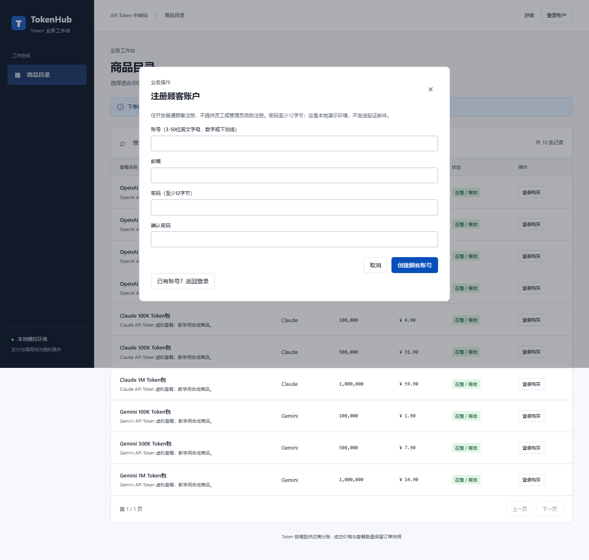

*图 3：实际 Edge 页面中的顾客注册表单。新建 `stage2_new_A01` 后自动成为顾客，可退出并再次登录。*

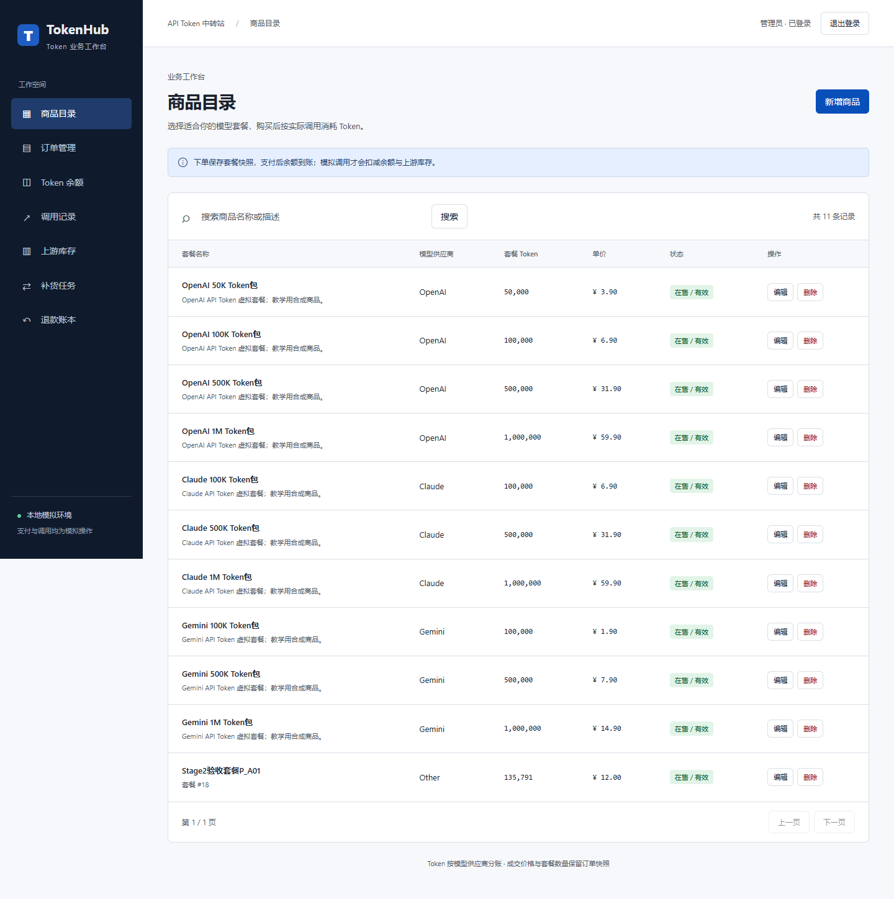

*图 4：管理员创建 Other 供应商商品 `Stage2验收套餐P_A01`，单价 12.00 元、135,791 Token；数据库生成商品 #18。随后创建上游账号 #18，初始库存 1,000,000 Token。*

### 4.2 顾客订单与支付

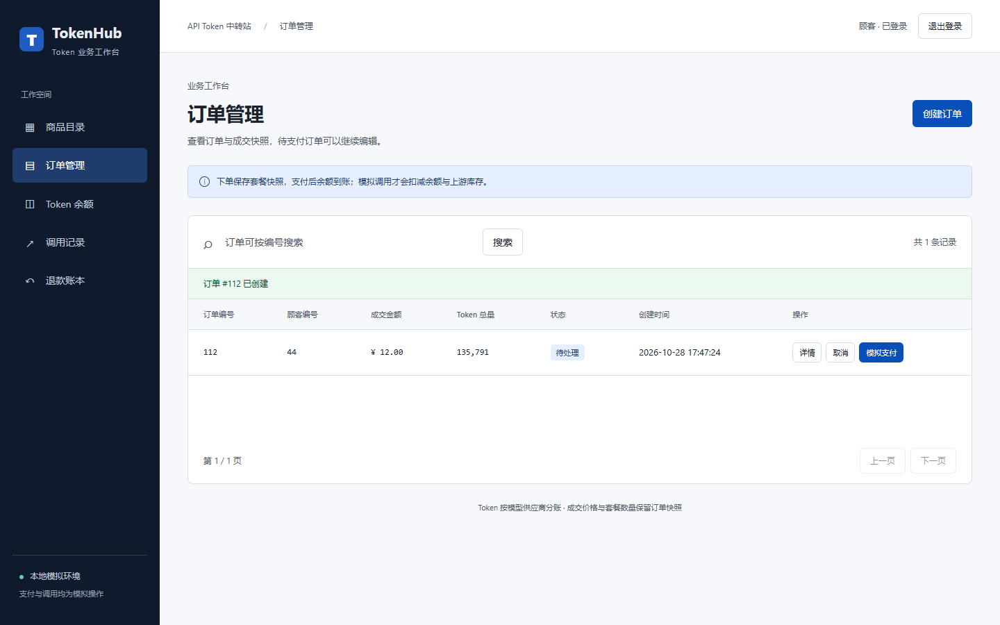

*图 5：顾客 `web_customer` 新建订单 #112，状态 pending，金额 12.00 元、135,791 Token。*

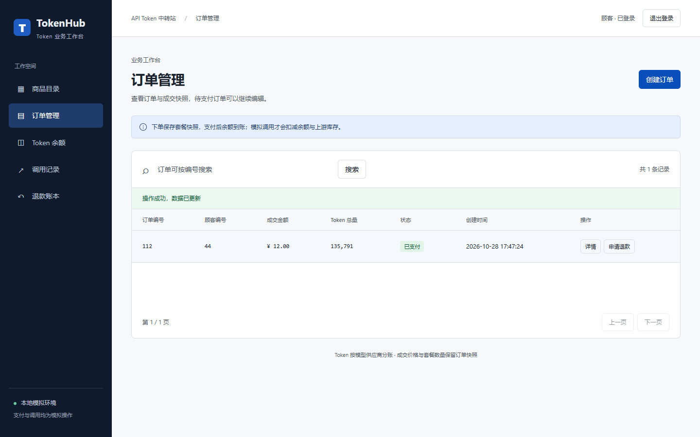

*图 6：点击模拟支付后，订单改为 paid，Token 进入顾客的 Other 供应商余额与购买批次；支付时不扣上游库存。*

### 4.3 Token 消费与退款结算

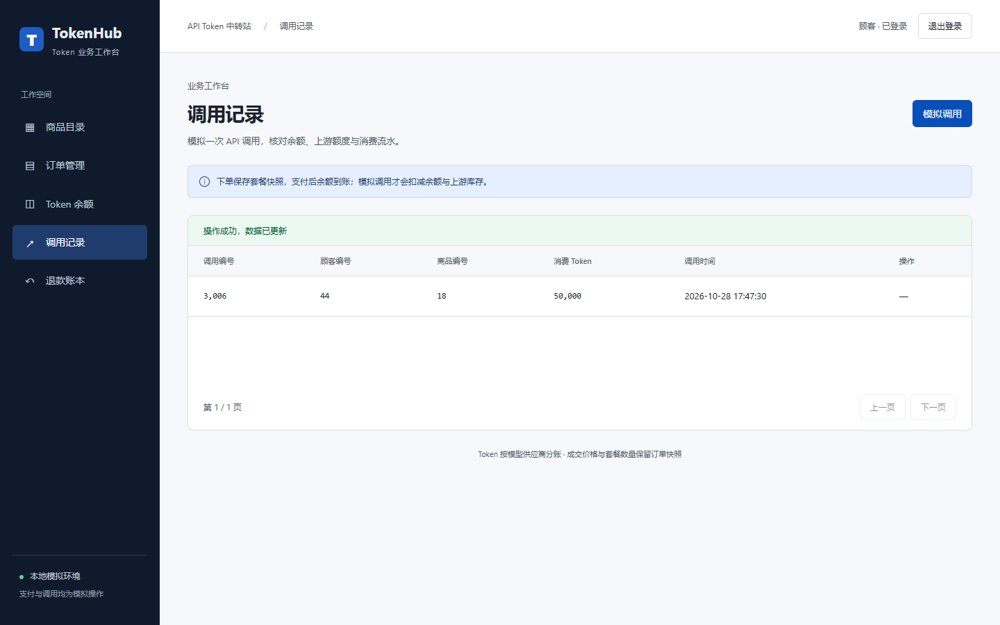

*图 7：消费 50,000 Token，剩余 85,791 Token。系统自动选中已有的 Other 上游账号 #17（而非本轮新建 #18），在该账号扣费并形成调用和库存流水。*

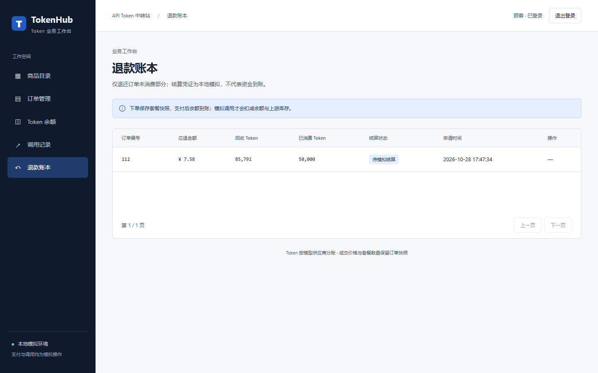

*图 8：顾客对订单 #112 申请退款，收回未消费的 85,791 Token，已消费 50,000 Token 不退款；账本给出应退 **7.58 元**，等待模拟结算。*

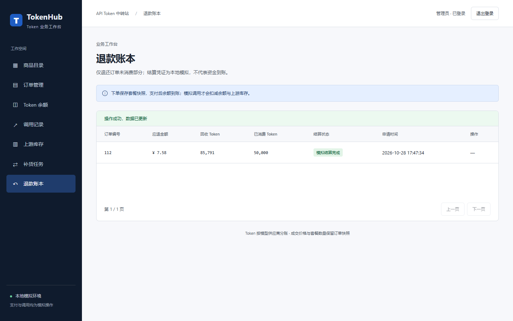

*图 9：管理员将该笔退款登记为 `settled`，生成 `SIM-` 开头的本地演示编号，**不代表实际资金已划转**。*

### 4.4 店员受控补货

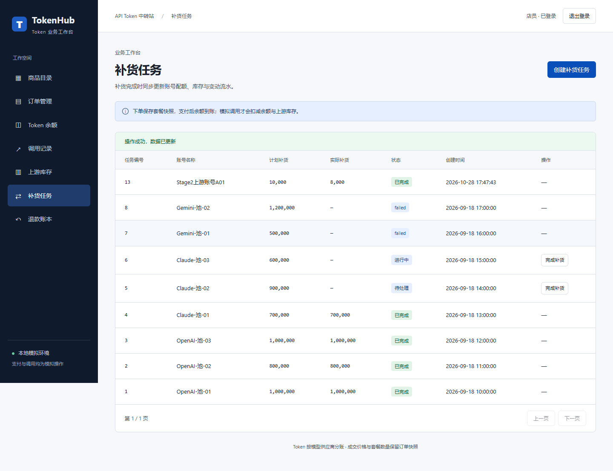

*图 10：店员对新建账号 #18 提交计划 10,000 Token、实际完成 8,000 Token 的补货任务；库存从 1,000,000 变为 1,008,000。*

## 5. 浏览器实测——异常、安全与统一反馈

所有请求统一返回 `code`、`message`、`data`、`request_id`，前端只显示简明提示和请求编号，不输出 SQL、服务器路径、密码或原始异常堆栈。后端记录时间、操作名、角色、错误分类和 HTTP 状态。

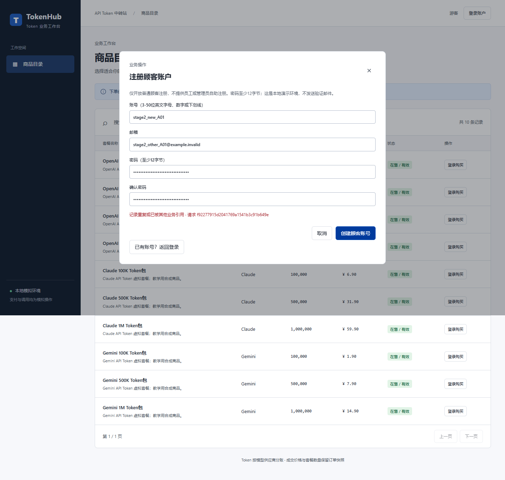

*图 11：注册使用已存在的用户名，被唯一性约束拒绝；读库确认注册用户仅 1 行，失败注册没有产生第二条账号。*


*图 12：错误密码返回统一的登录失败提示，不暴露密码哈希。*

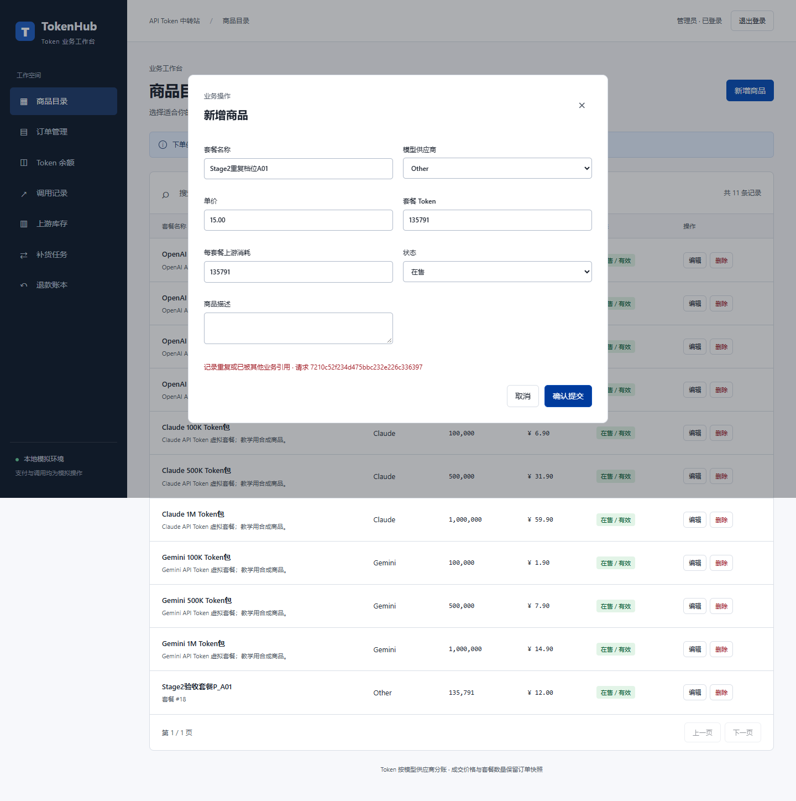

*图 13：管理员尝试创建相同供应商与 Token 档位商品，触发数据库 UNIQUE 约束，由 HTTP 错误边界转换为友好提示。*

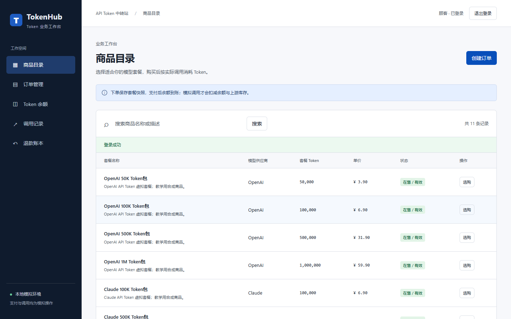

*图 14：`web_other` 的订单列表与第一位顾客隔离；同时直接通过 `GET /api/v1/orders/112` 发起越权访问，返回 403。此截图展示角色列表；403 的精确返回码见浏览器执行清单。*

| 异常或反例 | 实际响应 | 证据 |
|---|---|---|
| 新顾客重复用户名 | HTTP 409，约束冲突 | 图 11；只读计数 = 1 |
| 错误顾客密码 | HTTP 401，`LOGIN_FAILED` | 图 12 |
| 重复商品供应商/Token 档位 | HTTP 409，`CONSTRAINT_CONFLICT` | 图 13 |
| 非法负数消费 `tokens_used=-1` | HTTP 400，`INVALID_INPUT` | 请求 `46a2c3b8ef12438aaefd0215f34c6ce1` |
| 第二位顾客获取订单 #112 | HTTP 403，`FORBIDDEN` | 请求 `0b8a48de0b184266942755ec4ea51c17` |
| 店员尝试新建商品 | HTTP 403，`FORBIDDEN` | 请求 `502cee9f963a4d8cbe14043ba0958c57` |
| 退款后继续消费已回收余额 | HTTP 409，`BUSINESS_RULE` | 请求 `70bfe773251e4a5285eac632c079aab2` |
| 重复两次申请同笔退款 | 两次 HTTP 200，返回原退款数据 | 请求编号在 [执行清单](../result/stage2/WebStage2A02/browser/manifest.json) |
| 管理员删除已支付/已退款订单 | HTTP 409，`BUSINESS_RULE` | 请求 `82d201cc42994771ad60e1cd0e20f218` |
| 游客直接访问订单接口 | HTTP 401，未登录 | [真实接口页面截图](../result/stage2/WebStage2A02/browser/screenshots/21_游客访问订单401.png) |
| SQL 注入样式字符串作为商品搜索词 | HTTP 200，按普通文本处理，未执行 DDL | 执行清单及 18 表结构仍存在 |

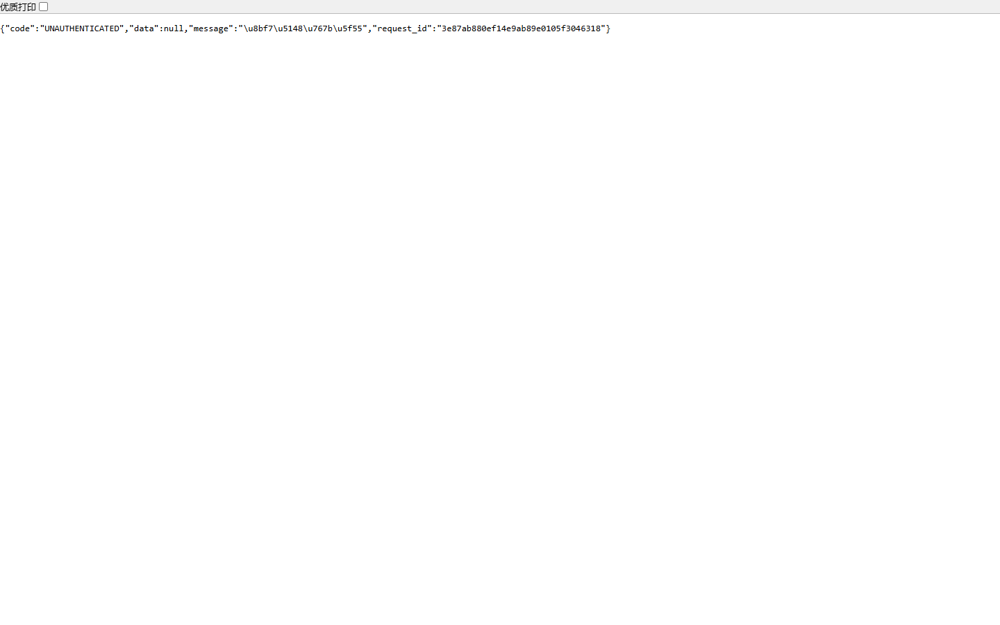

*图 15：游客在 Edge 地址栏直接访问受限 API，网站实际返回 401 JSON 错误，而非由测试脚本伪造的错误图。*

此外，完整自动化测试覆盖 CSRF 缺失、数据库连接失败脱敏、支付/补货/退款中途故障回滚，以及模拟并发冲突。此类故障注入主要由独立测试代码触发，**未将其伪装为浏览器截图中的故障现场**。

## 6. 只读 SQL 对账及自动化测试结果

对浏览器流程结束后的 `WebStage2A02` 数据库进行真实 SQL 查询，独立脚本执行 **25 项关键数据核验**；同时检查 22 张 PNG 的签名、尺寸和 SHA-256。结果均通过。

| 核对项目 | 浏览器前后业务事实及 SQL 查询结果 |
|---|---|
| 新顾客注册 | `stage2_new_A01` 仅 1 行，重复注册没有新增账户 |
| 订单和明细 | #112 仅 1 项明细，订单 12.00 元、135,791 Token；明细汇总与订单头一致 |
| 余额发放与消费 | 模拟支付获得 135,791 Token；成功调用消耗 50,000 Token |
| 退款 | 85,791 Token 回收，50,000 Token 已消费，退款 7.58 元，状态 `partially_refunded`、账本 `settled` |
| 退款后余额 | 顾客 Other 的现存余额 = 0 |
| 实际调用上游账号 | #17 `Web Other`，库存从 100,000,000 → **99,950,000**，该账号库存与流水求和相等 |
| 新增及补货账号 | #18 `Stage2上游账号A01`，1,000,000 + 8,000 → **1,008,000**，流水合计也为 1,008,000 |
| 当前数据库结构 | 18 张表、22 条启用可信外键 |
| 截图真实性 | 22 张由 Edge 生成的 PNG 均存在、尺寸有效、SHA-256 与执行清单一致 |

完整 JSON：[`database_reconciliation.json`](../result/stage2/WebStage2A02/database_reconciliation.json)。

另一套独立环境 `TokenHubDB_v11_WebSign28A` 的 **66 项 Python 测试全部通过（0 失败、0 跳过）**，包含旧数据库基础回归、Web SQL、HTTP 业务、登录与注册、安全边界、锁竞争和异常回滚。浏览器与数据库核对的证据是本轮新建的 `WebStage2A02`，不将不同数据库的结果混在同一“执行场次”中。交付前另执行了 [10 项最终 QA](../result/stage2/WebStage2A02/final_qa_manifest.json)，包括第5/6周图与链接、历史迁移回放核对、Ruff、实际网站 HTTP 登录、JS 语法、SQL 与截图哈希核验、Git diff 空白字符检查，全部通过。

## 7. 实验总结与交付边界

本阶段完成了从 v0.1 ER 建模、函数依赖和范式检查，到 v1.0 规范化迁移、v1.1 业务加固及 Web 四层应用的完整实现链。主要成果是：保留历史快照与有依据的受控冗余；将订单与 Token 更新纳入同一事务；通过双层角色检查及受限 SQL 过程保证店员、顾客、管理员权限；使用参数化调用、CSRF 与统一异常边界减少注入和内部信息泄露。浏览器及 SQL 联合验证可及时发现“上游账号自动选择”与“页面显示”等单层测试无法充分说明的问题。

**成员网站验收已完成：** 第一名测试组员陈诗翰在其环境先行测试（据阮依成确认）；第二名阮依成亲自在网站检查登录和订单显示，发现并要求修复缺失的注册功能。自动化22张浏览器截图与25项SQL对账另行记录，不冒充组员逐项手动截图。仍可补充在第二台全新Windows环境从零部署，以及使用真正受限Windows普通账户启动网站并核对权限。

本报告不声称验证了真实支付网关、真实上游模型 API 或真实退款到账。具体软件版本、操作手册、错误码与日志位置见[根 README](../README.md)、[Web 手册](../docs/webapp.md)、[第二阶段证据总览](../result/stage2/WebStage2A02/README.md)，任务归属见[小组分工](../docs/team_division.md)，AI 辅助过程见[AI 使用文档](../docs/ai使用文档.md)和[详细日志](../docs/ai_usage_log.md)。
