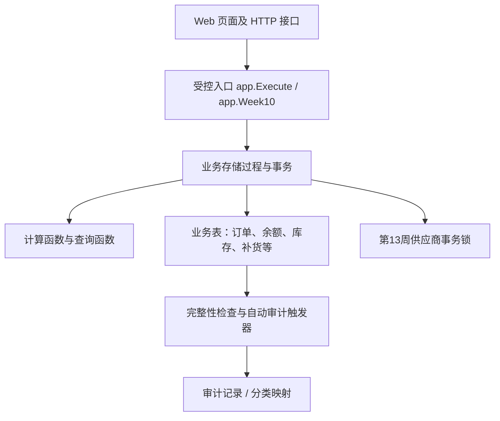
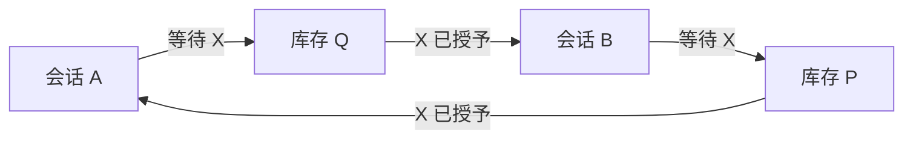

# TokenHub v2.0：数据库编程与事务处理实验报告

## 一、项目概况与设计思路

TokenHub 是面向 Token 套餐销售、模拟调用和上游额度管理的数据库应用。第三阶段（第10—13周）在已有数据库及 Flask Web 应用的基础上，进一步将统计计算、业务规则、数据完整性与并发控制落实到 SQL Server。交付版本为 v2.0，仍沿用内部 v1.1 基础库和周次增量，数据库名保持 `TokenHubDB_v11_<RunId>`，不另建一套相互独立的业务模型。

本阶段以订单完成与补货入库为两项核心事务，将商品分类、销售统计、库存审计和并发保护连接到同一业务链路：

- **数据库程序对象**：用存储过程处理参数校验、数据修改和事务，用函数实现可复用的查询与计算，用触发器处理数据变化时必须自动执行的约束检查和审计。
- **高级查询**：窗口函数在保留统计行的同时计算销售排名、累计值和移动平均；递归 CTE 查询分类及其全部后代，并维护商品的分类归属。
- **业务事务**：订单、余额与 Token 批次统一提交或回滚；补货单、账号总额度、库存流水和审计统一提交或回滚。
- **并发控制**：先在简化 P/Q 库存模型上观察锁和隔离现象，再将统一取锁顺序应用于实际订单和补货事务，验证有限可售额度下的并发竞购。

### 1.1 数据模型与对象分层

本项目出售的是 Token 套餐，而非独立的实物库存商品。多个商品可以对应同一供应商的上游账号额度，因此订单购买数量、顾客 Token 数和上游额度采用各自的计量单位。



| 增量 | 主要数据对象 | 设计作用 |
|---|---|---|
| 第10周 | `w10.InventoryAdjustments`；订单及明细的折扣快照字段 | 校正请求可追踪、可幂等重放；历史成交价不随当前价格改变 |
| 第11周 | `w11.InventoryAudit` | 自动记录库存增删改及业务操作者、连接登录名 |
| 第12周 | `w12.ProductCategories`、`w12.ProductCategoryAssignments` | 表达父子层级和商品分类映射 |
| 第13周 | `w12.usp_LockInventoryProvider`；独立 `w13lab` 实验对象 | 统一业务取锁规则；隔离 P/Q 并发现象实验 |

第10周完成后数据库为19张表、26条可信外键，较基础 Web 库增加1张校正记录表和4条外键。第13周的 P/Q 实验表仅在独立实验库初始化，不属于日常 Web 业务数据。第10周 ER 图及可编辑源见[结构图](er_diagram_week10.png)和[Mermaid 源文件](er_diagram_week10.mmd)。

## 二、第10周：存储过程与函数

### 2.1 对象职责、输入与输出

| 对象 | 类型 | 主要输入 | 输出、作用及异常处理 |
|---|---|---|---|
| `w10.usp_SalesStatistics` | 存储过程 | 开始、结束日期 | 返回总览和商品明细；拒绝空值、倒置日期，空销售区间总览为0 |
| `w10.usp_AdjustInventory` | 存储过程 | 商品、账号、调整量、原因、管理员、操作键 | 更新总额度与库存并保存调整记录；非法数量、账号、权限或冲突时拒绝并回滚 |
| `w10.fn_ReplenishmentQuantity` | 标量函数 | 商品、账号、最低量、目标量 | 返回 BIGINT 建议量，低于最低量时补至目标；已达到阈值返回0，非法输入返回 NULL |
| `w10.fn_SalesSummary` | 内联表值函数 | 开始、结束日期 | 返回商品编号、名称、销量、成交金额、订单数；非法日期返回空表 |
| `w10.fn_OrderDiscount` | 内联表值函数 | 订单原价 | 返回折扣率及优惠额；负值和 NULL 返回空表 |
| `w10.usp_RepriceDraft` | 内部存储过程 | 待支付订单 | 根据订单规则版本重算明细价格快照及订单合计 |
| `app.Week10` | 受控 Web 入口 | 会话令牌摘要、业务操作、JSON 参数 | 校验会话、角色和输入类型，返回 JSON；应用层不直接改基表 |

过程负责写入、异常和原子性；函数用于计算与查询，不承担修改业务数据的副作用。销售汇总函数可直接作为 SELECT 的数据源，例如：

```sql
SELECT *
FROM w10.fn_SalesSummary('2026-07-01', '2026-09-30');
```

销售按 `paid_at` 的 Asia/Shanghai 日期统计，包含起止两天；销量以套餐件数计算，订单数按订单去重。成交额保留后来发生退款的订单原成交金额，不等同于扣除退款后的净收入。

### 2.2 库存校正与折扣快照

库存校正时先检查管理员权限、商品与账号的供应商匹配关系、账号有效性和库存边界，再锁定相关账号与库存，同时修改总额度、当前库存，保留已用额度。原 `InventoryLog` 保存库存流水，新表 `w10.InventoryAdjustments` 通过 `log_id` 外键关联该流水，另外保存操作员工、原因、校正前后数值以及唯一操作键。

校正使用操作键保证幂等：同键同参返回原记录，不重复增减库存；同键异参拒绝请求。例：库存1000的账号收到一次+300校正后变为1300；即使因响应丢失再次提交相同的请求，库存仍为1300。

折扣规则为订单原价满100元优惠5%，满500元优惠10%，不满100元无折扣。订单保存规则版本，明细逐行保存原价小计、折扣率、优惠额和折后小计；每行舍入至分，订单金额取明细合计。例如原价200元的套餐成交金额190元，消费四分之一后，按未消费比例计算应退142.50元。历史订单采用 `legacy`，新订单采用 `amount-v1`，已成交价格受保护。

### 2.3 实验验证

| 验证项目 | 结果 |
|---|---|
| 第10周正常、异常与重复调用 | 40项逐例验证通过，记录输入、预期、实际及错误信息 |
| 第10周全量回归 | 115项通过，0失败、0错误、0跳过 |
| 函数与过程边界 | 覆盖阈值、NULL、非法日期、空销售区间、库存正负校正及同键重放 |
| 安装失败回滚 | 注入56998后结构及数据回滚，历史保护恢复 |
| 账务与历史数据保护 | 安装前后8张核心表计数及校验一致；校正、余额及快照一致性检查通过 |

原始记录：[40项逐例结果](../result/week10/W10FinalVerify03/results.json)、[独立 SQL 回归](../result/week10/WebW10Final03/sql_regression.log)、[115项日志](../result/week10/WebW10Final03/full_unittest.log)、[安装回滚](../result/week10/WebW10Rollback1/rollback_result.json)。对象及参数的详细定义见[第10周报告](week10_report.md)和[SQL说明](../sql/week10/README.md)。

## 三、第11周：触发器与窗口函数

### 3.1 库存审计及订单完成规则

库存审计触发器 `dbo.trg_W11_InventoryAudit` 对 `Inventory` 的 INSERT、UPDATE、DELETE 自动响应，通过 `inserted` 和 `deleted` 按库存编号进行全外连接，逐行比较修改前后额度。一条语句影响多行时生成相应的多条审计；仅时间戳变化、库存数量不变时不生成库存变化记录。

审计记录包括账号编号、供应商、操作类型、前后额度、变化量、操作时间、业务操作者和 `ORIGINAL_LOGIN()`。库存以账号为单位，商品编号通过 `w11.v_InventoryAuditProduct` 按供应商关联获得；同一条审计可能对应同供应商的多个商品，而非把该库存变化重复记账。审计表仅允许追加，修改或删除报54409。业务回滚时同一事务内的审计一并回滚。

订单完成规则触发器 `dbo.trg_W11_OrderCompletionRules` 将本次进入已完成（`paid`）状态的订单作为集合统一核验，不只读取单行。

| 规则检查 | 错误号 |
|---|---:|
| 已完成或已退款订单重复完成 | 54401 |
| 原状态不是待支付 | 54402 |
| 缺少订单明细 | 54403 |
| 商品或购买数量、Token 数据非法 | 54404 |
| 订单金额、Token 与明细合计不一致 | 54405 |
| 按供应商汇总的上游需求超过可售余量 | 54406 |

任一订单不满足规则时拒绝整条语句。由此，规则不依赖 Web 页面是否隐藏某个按钮，也不因一次 SQL 批量修改而只校验其中一行。

### 3.2 三类窗口查询

窗口查询使用与第10周一致的成交额口径，统计日期来自 `paid_at`。

| 查询 | 核心逻辑 | 样例结果及用途 |
|---|---|---|
| 排名 | RANK、DENSE_RANK、ROW_NUMBER；按成交金额排名，并按供应商统计销量名次 | Claude 1M Token包成交额1018.30元，排名第一；OpenAI 100K 和 Claude 100K 同为131.10元，RANK 同为6、下一名为8，DENSE_RANK 下一名为7 |
| 累计值 | 按 `sale_date` 升序；`ROWS BETWEEN UNBOUNDED PRECEDING AND CURRENT ROW` | 2026-07-01成交133.60元，截至该区间最后成交日09-21累计4294.60元、194件，观察销售进度 |
| 移动平均 | 先用日历补齐无成交日，再用 `ROWS BETWEEN 2 PRECEDING AND CURRENT ROW` | 2026-07-03三日均额为(133.60+0+160.00)/3=97.87元；平滑单日波动，辅助补货 |

这里移动平均是最近三个自然日，而不是最近三条成交记录；统计区间前两天不足三个自然日时，输出实际窗口天数。

### 3.3 实验验证

触发器验证覆盖单条插入、单条更新、批量更新、无额度变化、非法库存、审计不可修改及订单完成拒绝。后续加入实际连接登录名和审计对应商品视图的检查。最终14项全部符合，`@@TRANCOUNT=0`；三类窗口查询正常运行。

原始记录：[窗口查询输出（WebXY1123H）](../result/week11/WebXY1123H/window_query.log)、[第11—12周验收（WebXY1124D）](../result/week12/WebXY1124D/README.md)。详见[第11周报告](week11_report.md)和[SQL说明](../sql/week11/README.md)。

## 四、第12周：递归查询与业务事务

### 4.1 商品分类层级和递归 CTE

`w12.ProductCategories.parent_id` 自引用分类表主键，根节点的父级为 NULL；`w12.ProductCategoryAssignments` 连接商品与所属分类。样例结构如下：

```text
1 全部Token套餐
├─ 2 文本对话模型
│  ├─ 4 OpenAI套餐
│  │  ├─ 8 OpenAI小容量（≤100K）
│  │  └─ 9 OpenAI大容量（>100K）
│  └─ 5 Claude套餐
└─ 3 多模态与其他
   ├─ 6 Gemini套餐
   └─ 7 Other套餐
```

`w12.fn_CategoryDescendants` 的锚点取指定分类，层级为0；递归成员按 `child.parent_id = parent.category_id` 连接、层级加1并追加路径。路径使用相同的 NVARCHAR(400) 类型；查询排除已在路径中的节点，限制深度32，并通过 MAXRECURSION 限制递归次数。分类外键不能独自防止成环，因此另有 `w12.trg_CategoryNoCycle` 拒绝形成循环或超出深度的父级修改。

| 起始分类 | 实际行数 | 验证结果 |
|---|---:|---|
| 根节点1 | 9 | 返回全部节点，层级0—3 |
| 中间节点2 | 5 | 返回2、4、8、9、5 |
| 叶子节点8 | 1 | 只返回自身 |
| 不存在的999 | 0 | 无记录，脚本提示分类不存在 |

根到叶的路径示例为 `/1/2/4/8/`。原始结果：[递归查询日志](../result/week12/WebXY1124D/recursive_query.log)。

人工复查发现商品分类映射最初仅在安装时建立，后续商品变化可能导致分类统计失真。修正后，`dbo.trg_W12_ProductCategoryAssignments` 对 INSERT、UPDATE 自动维护映射，OpenAI 按100K阈值分到8或9，Claude、Gemini、Other 分到5、6、7；商品成功删除时由映射表外键 `ON DELETE CASCADE` 删除对应关系。既有历史订单与调用记录的保护约束仍生效。新增、容量跨阈值、供应商变化、删除等6项测试全部通过。

### 4.2 订单完成事务

订单支付后发放顾客可用 Token，实际模拟调用才消耗上游库存。因此订单完成应先预占可售余量，而不是再次扣减物理库存。

上游可售余量 = 有效账号可用上游额度合计 − 已售未消费且未退款部分对应的上游需求。

```text
Web orders.pay
  → app.Execute（外层事务）
  → dbo.usp_W6_PayPendingOrder
  → w12.usp_CompleteOrder
      ① 锁定待支付订单及明细，检查买家、数量、金额、折扣快照
      ② 按商品、供应商汇总 Token 和上游额度需求
      ③ 按供应商名称升序取得第13周共用事务锁
      ④ 锁定余额和账号，核对可售余量
      ⑤ 增加顾客余额，更新订单状态，逐明细发放 Token 批次
      ⑥ 提交；异常时回滚整个事务
```

完成时使用状态条件更新 `WHERE order_id=@order_id AND status='pending'`，检查 `@@ROWCOUNT`，防止同一订单重复发放。更新 Orders 时第11周触发器再次校验明细、金额和可售余量。`paid` 是已完成状态，不另设重复语义的状态。

### 4.3 模拟补货入库事务

补货任务保存上游账号、计划补货量、状态、实际入库量和完成时间。员工提交实际到货量后，事务检查单据和数量是否合法，再执行额度和库存更新。

```text
Web restocks.complete
  → app.Execute（外层事务）
  → dbo.usp_W6_RestockAccount
  → w12.usp_ReceiveRestock
      ① 锁定补货单，检查状态与实际入库量
      ② 取得对应供应商的共用事务锁
      ③ 锁定账号与库存，核对范围和账务等式
      ④ 增加总额度与库存，写入 InventoryLog
         Inventory 更新同时触发 InventoryAudit
      ⑤ 更新补货单为 completed，保存实际量与完成时间
      ⑥ 核对库存等式后提交；异常时整体回滚
```

状态条件限定 `pending` 或 `in_progress`，已完成单据不会重复入库。两项事务均使用 SERIALIZABLE、TRY/CATCH、XACT_ABORT；异常处理重新抛出错误。通过 Web 调用时，过程内部 COMMIT 不会提前释放外层事务所持有的锁，外层统一提交或回滚。

### 4.4 提交、回滚与重复调用验证

以下摘要采用第13周最终专项复验批次 WebW13Fix01 对现行事务的测试结果：

| 业务及场景 | 实测结果 |
|---|---|
| 订单正常完成 | 订单114含P×3、Q×1；状态 paid，余额由0增至560988，产生2条批次 |
| 同一订单重复完成 | 53131；余额、批次不变 |
| 余额写入后主动失败 | 54490；订单115仍 pending，余额恢复560988，批次为0；去除故障点后可正常完成 |
| 订单不存在、无明细、可售额度不足 | 53123、53125、53132；拒绝订单未完成，无完成时间，无新增余额和批次 |
| 补货正常入库 | 补货单14实际入库8000；库存和总额度均由100000增至108000，流水和审计各增加1，状态 completed |
| 重复入库 | 53311；库存、总额度、流水、审计及完成信息不变 |
| 库存增加后主动失败 | 54491；库存、总额度、流水、审计恢复到原值，补货单15仍 pending，实际量和入库时间为空 |
| 非法补货量、不存在或已关闭单据 | 53303、53310、53312；不产生业务写入 |
| 一致性检查 | 库存与总额度减已用的差值为0；余额与未消费批次合计的差值为0；事务计数0 |

两项中途失败均发生在部分写入之后，因此证明的不仅是非法参数拒绝，还包括已写入数据的回滚。专项事务用例14/14通过（含53313防御性检查的可达性核对：本样例库无法触发该分支）。Web 原入口复验及异常代码见[原始事务日志](../result/week13/WebW13Fix01/test_transactions.log)、[第12周报告](week12_report.md)。

## 五、第13周：并发控制

### 5.1 实验基线与观察方法

实验采用独立数据库 WebW13Run03 完成正式验收，随后在 WebW13Fix01 对审查修复后的实现再次验证。每个实验按 A、B 两个连接的步骤交错执行，另用观察连接查询 `sys.dm_exec_requests`、`sys.dm_tran_locks`，记录资源类型、锁模式、授予/等待状态及阻塞会话。所有实验均使用专用数据。

| 参数 | 正式批次 WebW13Run03 | 修复批次 WebW13Fix01 |
|---|---|---|
| SQL Server 版本 | 17.0.1000.7 | 17.0.1000.7 |
| A/B/观察连接 SPID | 97/98/99 | 52/53/54 |
| 初始隔离级别 | READ COMMITTED | READ COMMITTED |
| READ_COMMITTED_SNAPSHOT | OFF | OFF |
| P/Q 初始库存 | 10/8 | 10/8 |

P/Q 使用 `w13lab.Stock` 简化库存表，配套订单和补货状态表。这使现象实验中的商品键、取锁顺序和结果可以明确复现；实际业务另用 Token 可售额度验证。RCSI 未被修改。

### 5.2 同一库存的写入等待

| 步骤 | A提交轮 | A回滚轮 |
|---|---|---|
| A1 | 订单事务将P从10减至8，持有X锁 | 同左 |
| B1 | 补货事务请求P的X锁，被阻塞 | 同左 |
| A2 | 完成订单并提交，释放锁 | 回滚订单，P恢复10 |
| B继续 | 增加5并提交 | 增加5并提交 |
| 最终 | P=13，订单 paid，补货 completed | P=15，订单 pending，补货 completed |

两轮均观察到 `LCK_M_X`。修复批次中 A（52）持有 Stock 的 KEY X 锁（GRANT），B（53）对同一键请求 X 锁（WAIT）。只有 A 释放锁后 B 才能继续。最终数量不同的原因是第一轮订单扣减生效，第二轮订单扣减被整体撤销。

### 5.3 隔离级别对照

| 实验 | 两会话顺序及实际读值 | 结论 |
|---|---|---|
| READ UNCOMMITTED | A补货未提交，P=15；B读取15；A回滚，P=10 | B读取了后来被撤销的数据，产生脏读 |
| READ COMMITTED | A补货未提交；B等待（LCK_M_S）；A回滚，B读取10 | 本库RCSI关闭，普通RC读通过锁避免脏读 |
| READCOMMITTEDLOCK | 相同基线；B等待A回滚后读取10 | 显式锁式已提交读对照 |
| READ COMMITTED | A第一次读10；B补货提交；A第二次读15 | 同一事务中发生不可重复读 |
| REPEATABLE READ | A第一次读10并持有S锁；B请求X锁等待；A第二次仍读10并提交；B完成后P=15 | 保留已读数据的共享锁，阻止本例中的不可重复读 |

RCSI 开启时，普通 READ COMMITTED 可以读取先前已提交的行版本；本项目仅解释该行为，没有在开启 RCSI 的数据库上进行额外实测。REPEATABLE READ 保护已读取的键，不能由此推断幻读等所有并发问题均已解决。

### 5.4 死锁复现、失败回滚和改进

反序实验中 A 先更新P，B先更新Q；A再请求Q而等待，B再请求P，产生循环等待：



DMV 快照将 P、Q 对应到 `w13lab.Stock` 的 KEY 资源，键描述分别为 `(8194443284a0)`、`(61a06abd401c)`。A等待Q时已记录 A持有P、B持有Q、A等待Q；随后 B 请求P并被 SQL Server 选为低死锁优先级的牺牲者，返回1205。错误捕获时 `XACT_STATE()=-1`、事务计数1，显式清理后为0。

| 场景 | A顺序 | B顺序 | 实际结果 |
|---|---|---|---|
| 反序 | P→Q，各减2 | Q→P，各加5 | B报1205并回滚；A提交，P=8、Q=6；补货 pending |
| 同序 | P→Q，各减2 | P→Q，各加5 | B先在P等待，不持有Q；两边均提交，P=13、Q=11 |

同序更新让 B 在第一个共同资源上排队，消除了本例的反向锁依赖。它不是“消除全部死锁”的保证，普通等待仍会出现。

### 5.5 改进应用于业务事务

实际业务的并发资源为供应商共享的上游额度，而不是独立商品库存。第13周将简化实验的固定取锁顺序应用到两个业务过程：订单按供应商名称升序逐项取得入口锁，补货取得其单一供应商入口锁；之后仍执行原有账号行锁、余额检查、库存与审计规则。

核心入口锁为 `w12.usp_LockInventoryProvider`，锁名统一为 `TokenHub.Inventory.<规范供应商名>`，使用事务所有权的 Exclusive 应用锁。关键 SQL 如下（省略参数规范化及错误处理）：

```sql
EXEC @result = sys.sp_getapplock
    @Resource = @resource,
    @LockMode = 'Exclusive',
    @LockOwner = 'Transaction',
    @LockTimeout = 10000,
    @DbPrincipal = 'public';
IF @result < 0
    THROW 55009, 'Could not acquire inventory provider lock', 1;
```

审查中发现供应商大小写等拼写变体可能形成不同的二进制锁名，部分手工写入脚本在锁超时后缺少整体回滚，Web 补货等待超时返回503。修复后规范化四个供应商锁名、补齐异常回滚，并将单次入口锁等待上限调整为10秒以给 Web 命令超时留出余量。最新3项专项回归全部通过：别名取得相同锁、第二库存键超时撤销第一笔写入、Web 补货超时返回409且所有相关数据不变。

### 5.6 实际业务竞购

WebW13Fix01 中，两会话同时完成不同订单，各购买P×6，初始可售量为10份。A先取得 Other 的 APPLICATION X 锁，B请求同名锁并出现 `LCK_M_X`；A提交后，B重新核对可售余量并返回53132。

| 数据 | 成功订单112 | 失败订单113 |
|---|---|---|
| 购买数量 | 6 | 6 |
| 状态 | paid | pending |
| 发放顾客 Token | 550218 | 0 |
| 新增 Token 批次 | 1 | 0 |
| 完成结果 | 成功 | 53132，可售额度不足 |

每份套餐需上游额度10000001，初始可售100000010，提交后已售待消耗60000006，物理可用额度仍为100000010，可售余量为40000004，即4份。失败订单没有完成时间、余额或批次新增。本项目因此在支付环节避免重复占用可售额度，并保留实际调用时扣减物理库存的业务规则。

实际订单与补货也验证共用同一 Other 入口锁：A订单事务持锁时B补货等待；A回滚后B可入库；为保留竞购基准，随后B回滚外层事务，补货单恢复 pending。

第13周证据：[正式原始并发记录](../result/week13/WebW13Run03/concurrency.jsonl)、[最新并发记录](../result/week13/WebW13Fix01/concurrency.jsonl)、[3项审查复验](../result/week13/WebW13Fix01/review_final.log)、[第13周报告](week13_report.md)。

## 六、综合验证及版本复现

| 批次 | 验证范围 | 结果 |
|---|---|---|
| WebW10Final03 / W10FinalVerify03 | 第10周安装、业务回归与专项用例 | 全量115项、专项40项通过 |
| WebXY1124D | 第10—12周全量回归、分类维护、触发器及业务事务 | 126项通过、0跳过；分类6/6、触发器14/14、事务14/14 |
| WebW13Run03 | 第13周正式双会话实验及第10—12周回归 | 并发场景通过；全量126项通过、0跳过 |
| WebW13Fix01 | 最后一次审查修复后的并发与事务复验 | 专项3/3、各并发场景通过、事务14/14；事务计数0 |

各批次结果独立记录，126项全量与最后新增3项专项来自不同批次，不能合并为同一轮129项全量验收。最后一次修复后的统一全量回归尚未执行；第13周未重新验收完整浏览器流程及普通Windows受限账户运行路径。

复现时在 Windows、SQL Server Express、ODBC Driver 18 和项目 Python 环境中，使用唯一的 WebW13 批次后缀。构建顺序为基础 v0.1 → v1.0 → v1.1/Web → 第10周 → 第11周 → 第12周（同时安装第13周共用锁）。随后在隔离库运行各周测试，再执行 `tools/week13_verify.py` 或按 A/B 脚本分段操作。不得将两个会话的全部脚本一次执行。每轮结束检查事务计数、恢复会话设置并重置实验数据；最终关闭连接，按 RunId 清理数据库与备份并保留结果。

主要入口：[根 README](../README.md)、[第10周](../sql/week10/README.md)、[第11周](../sql/week11/README.md)、[第12周](../sql/week12/README.md)、[第13周双会话脚本](../sql/week13/README.md)、[正式批次](../result/week13/WebW13Run03/README.md)、[最后修复批次](../result/week13/WebW13Fix01/README.md)。

## 七、组内分工与 AI 辅助记录

| 组员 | 第三阶段主要工作 |
|---|---|
| 陈诗翰 | 第10周存储过程、函数和折扣业务；第11周窗口查询与触发器测试结果；第13周锁等待、隔离级别、死锁与改进、实际业务竞购及回归验证 |
| 肖懿 | 第11—12周主要实现与验收，包括库存审计、订单完成规则触发器、两个业务事务、Web入口整合、并发复查与受限账户补验收 |
| 阮依成 | 第12周分类层级、递归查询、事务证据核对；人工发现分类映射未随商品变化自动维护并提出修复；第三阶段交付整理和历史资料归档 |

完整分工及对应证据见[组内分工](../docs/team_division.md)。AI 辅助方案、实现调整、人工反馈、故障与验证记录见[AI使用文档](../docs/ai使用文档.md)及[详细日志](../docs/ai_usage_log.md)。

## 八、实验总结

第三阶段将销售统计、库存调整、折扣计算等可复用逻辑下沉至 SQL Server，并利用触发器保护多行修改和订单状态转换。窗口函数提供按商品和日期的销售分析，递归 CTE 支持分类层级检索，商品分类映射随业务数据变化自动维护。

订单完成和模拟补货通过统一事务边界保证状态、余额、批次、库存流水及审计之间的一致性。故障注入验证部分写入能够全部撤销，重复调用不产生额外发放或重复入库。并发实验进一步观察了排他锁等待、脏读、不可重复读和死锁，并通过统一取锁顺序降低所验证路径中的循环等待风险；实际竞购验证两张订单不能重复占用同一可售额度。

本阶段核心技术任务已经实现并留有原始证据，适用于后续基于销售与库存数据的预测补货研究。当前仍需区分可售额度预占与物理库存扣减的业务口径；非 active 账号入库后是否恢复可售状态及更细粒度的 Web 冲突提示仍待进一步决定。提交前建议在新隔离库对最后修复版本执行一次统一全量回归，避免将不同时期的验证结果混作同一批次。
