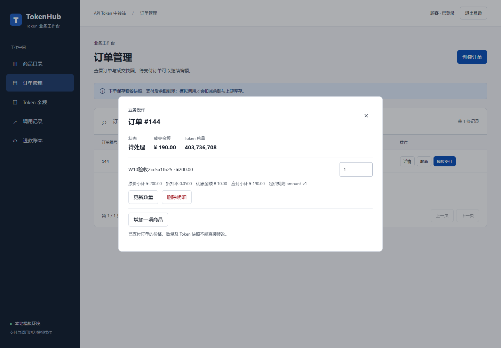
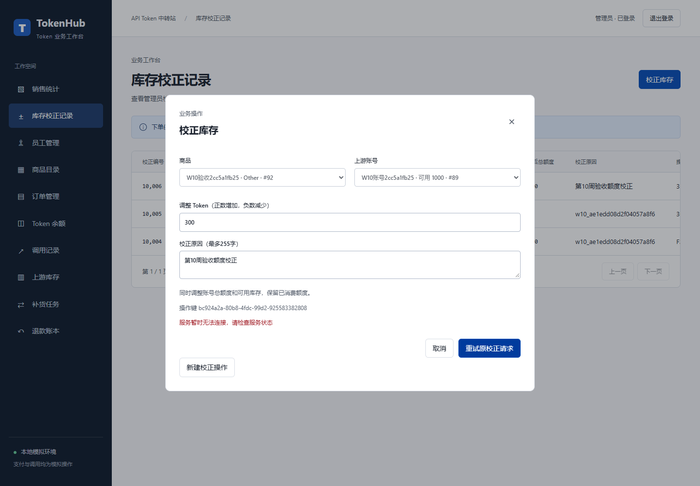

# 第10周存储过程与函数报告

## 实现范围

在内部v1.1与Web基线上新增w10扩展，使用`tools/app_prepare.py --with-week10`从空库复现。第10周增量为19张表、26条启用可信外键，第二阶段保留原18表模型。

| 对象 | 类型与用途 |
|---|---|
| w10.usp_SalesStatistics | 过程，日期区间总览及商品明细，同次物化读取 |
| w10.usp_AdjustInventory | 过程，锁定账号/库存并写调整与流水，操作键控制重放 |
| w10.fn_ReplenishmentQuantity | 标量函数，按最低量与目标量返回BIGINT建议量 |
| w10.fn_SalesSummary | 内联表值函数，可在SELECT中查询商品成交汇总 |
| w10.fn_OrderDiscount | 内联表值函数，返回金额阶梯折扣率及试算优惠额 |
| w10.usp_RepriceDraft | 内部过程，按订单版本重算逐行快照与汇总 |
| app.Week10 | 受限Web入口，会话、角色、字段与类型检查 |

过程承担写入、事务与异常处理，函数承担查询和计算。函数对非法参数返回NULL或空表，应用包装过程将其转为明确业务错误。参数、调用例子与错误号见[SQL说明](../sql/week10/README.md)。

## 业务口径

销售按paid_at的Asia/Shanghai日期统计，包含首尾两天。状态包括paid、refunded、partially_refunded，成交额保留后续退款订单的原成交额。销量为套餐件数，跨商品总订单数去重。空区间总览为0，明细为空数组。

库存按上游账号保存，过程同时接收商品和账号并验证供应商匹配。调整同时改变total_quota与current_quota，保留used_quota。流水manual引用保持reference_id为空，由调整表log_id外键关联。正负范围、账号有效期和余额等式均在事务中检查。

金额满100元优惠5%、满500元优惠10%。新订单保存amount-v1，旧订单保存legacy。原价小计、折扣率、优惠额与折后小计逐行保存，单价保留首次快照。每行舍入到分，订单金额取明细合计。200元一件实付190元，消费四分之一后回收剩余Token，应退142.50元。

空草稿在Orders保存规则版本。已成交明细继续受保护触发器约束。安装事务临时处理历史回填，恢复保护后校验可信约束。销售包含既有部分退款状态。

## 实际验证

| 检查 | 实际结果与证据 |
|---|---|
| 原业务基线 | 75项通过，0跳过，[日志](../result/week10/WebW10Base01/unittest_attempt2.log) |
| 最新完整新库 | WebW10Final03从v0.1构建至Web及第10周成功，[构建日志](../result/week10/WebW10Final03/prepare.log) |
| 全量Python测试 | 115项通过，0失败/错误/跳过，[日志](../result/week10/WebW10Final03/full_unittest.log) |
| 第10周逐例结果 | 40项通过，保存输入、断言预期/实际和错误，[结果](../result/week10/W10FinalVerify03/results.json) |
| SQL独立调用回归 | 通过，阈值、销售、空日期、库存和幂等断言，[日志](../result/week10/WebW10Final03/sql_regression.log) |
| 新页面Edge流程 | 10张截图，含已提交响应丢失、重开后原键重试，[清单](../result/week10/WebW10Final03/browser_attempt02/manifest.json) |
| 安装失败回滚 | 注入56998，结构及数据回滚，保护恢复，[结果](../result/week10/WebW10Rollback1/rollback_result.json) |
| 安装前后对账 | 8张核心表计数/校验和一致，见result/webapp/WebW10Final03/week10_before.json和week10_after.json |
| 安装后账务检查 | 19表26FK，库存差异/负余额/批次超用/快照错误/禁用触发器均为0，[结果](../result/week10/WebW10Final03/accounting_checks.json) |
| 普通Windows身份 | 待补做，当前有效管理员令牌为false，[预检](../result/week10/WebW10Final03/runtime_preflight.json) |

两连接测试覆盖同键校正、并发负校正及重复支付，故障注入覆盖调整流水、支付批次和退款账本。受限SQL用户矩阵与内部过程拒绝通过，当前服务以开发预览方式连接。

旧业务浏览器追加回归在补货步骤遇到“补货”与“补货建议”按钮定位冲突，保留18张过程/失败截图；已把旧脚本改为精确匹配，完整旧脚本本轮未重新运行。原注册、支付、退款和新增补货流程分别有本轮浏览器或115项集成测试结果。追加运行状态见[证据索引](../result/week10/README.md)。

## 结构与后续

[第10周ER](er_diagram_week10.png)保留[可编辑源](er_diagram_week10.mmd)与[渲染脚本](render_week10_er.py)，字段见[增量字典](../docs/app_data_dictionary.md)。函数与受控入口为第11—13周后续任务提供基础。普通Windows运行身份的第10周入口验收仍需在提升权限环境补做。

员工管理追加Edge验收11张截图通过，见[清单](../result/week10/WebW10Final03/employee_browser_attempt01/manifest.json)。本轮预览已关闭，5052无监听，见[关闭记录](../result/week10/WebW10Final03/shutdown.json)。
